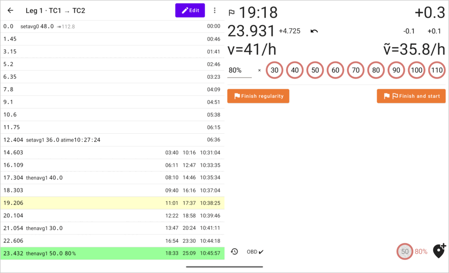

#  h0tk3y's Rally Tool

An Android app for the co-driver in TSD (time–speed–distance) regularity rallies.

- Live early/late timing to a tenth of a second
- Distance from GPS or an OBD (ELM327) reader
- Records the road book as you drive: one tap per regularity start, speed change and finish
- Flexible speed management, with percentage
- A second screen for the driver over Wi-Fi

**Download:** [latest release](https://github.com/h0tk3y/rally/releases/latest) (`android-release.apk`)

**User guide:** [English](docs/user-guide.md) · [Русский](docs/user-guide.ru.md)
