# h0tk3y's Rally Tool: user guide

*[Русская версия](user-guide.ru.md)*

This guide is for the co-driver in a TSD (time–speed–distance) rally. It explains how you prepare a section, how you use the app in the car, and how the app calculates the times.

## Contents

1. [What the app does](#1-what-the-app-does)
2. [Words used in this guide](#2-words-used-in-this-guide)
3. [Quick start](#3-quick-start)
4. [The section list](#4-the-section-list)
5. [The section screen](#5-the-section-screen)
6. [Race mode](#6-race-mode)
7. [A rally day with the app](#7-a-rally-day-with-the-app)
8. [Allowance](#8-allowance)
9. [Measuring the distance](#9-measuring-the-distance)
10. [Settings](#10-settings)
11. [The driver's screen (Driver HUD)](#11-the-drivers-screen-driver-hud)
12. [Saving, copying and sharing](#12-saving-copying-and-sharing)
13. [Questions and problems](#13-questions-and-problems)

[Advanced topics](#advanced-topics):

14. [How the app calculates the times](#14-how-the-app-calculates-the-times)
15. [Editing positions](#15-editing-positions)
16. [How race mode builds your roadmap](#16-how-race-mode-builds-your-roadmap)
17. [Errors and warnings](#17-errors-and-warnings)
18. [Importing a section](#18-importing-a-section)

---

## 1. What the app does

- **Times you in the car.** In race mode the app shows the clock, the distance you drove and how many seconds you are early or late. It measures the distance from GPS, from the car through an ELM327 (OBD) reader, or from a driving game for training.
- **Records the road book as you drive.** You create a section with only its length, its average speed or time, and its start time. In the car, you tap a button when a regularity starts, when the set speed changes and when the regularity ends. The app writes each of these into the section's list of points, the **roadmap**.
- **Shows the driver the same data** on a second device.

You can also change the roadmap by hand with the app's editor. This is for fixing mistakes and for quick calculations; see [Editing positions](#15-editing-positions).

---

## 2. Words used in this guide

| Word | Meaning in this app |
|---|---|
| **Section** | A part of the rally that you time as one, for example a liaison from one time control to the next. The app keeps many sections. |
| **Position** | One row of a section: a point on the road, with its distance in km. A position can carry marks. |
| **Roadmap** | All the positions of a section, in order of distance: the app's copy of your road book. |
| **Mark** | Extra information on a position. The app writes the marks in short form: `setavg` (a set average speed starts), `thenavg` (the set average speed changes), `endavg` (a set average speed ends) and `atime` (time of day). |
| **Stretch** | Part of the road from the point where a set average speed starts to the point where it ends. |
| **Inner stretch** | A stretch inside a longer stretch, with its own speed. A regularity inside a liaison is an inner stretch. The app's messages call these "subs". |
| **Time of day** | The real time on the rally clock at a position, for example 10:00:00. The app calls it `atime` ("astronomical time"). |
| **Race mode** | The mode you use in the car. A panel (the **race panel**) appears below the list with the clock, the distance and how early or late you are. |
| **Section timer** | In race mode, a clock that times the whole section at its overall average speed. You start it from the row of buttons called **Go**. |
| **Regularity timer** | In race mode, a clock that times a regularity, where each set average speed counts. You start it from the row of buttons called **Regularity**, or, while the section timer runs, from the row called **Start regularity:**. |
| **Distance source** | Where the app gets the distance and speed: GPS, a reader in the car, a driving game, or the simulation slider. |

---

## 3. Quick start

**Before the rally, usually the day before:** if you use a reader in the car (OBD), set it up in Settings (see [Telemetry source](#101-telemetry-source)), then calibrate it on the calibration route that the organisers publish in advance (see [Calibration](#102-calibration)). With GPS you can skip this.

**When you get the road book, right before the start:**

1. On the first screen, tap **+** (Create section; see [Create a section](#41-create-a-section)).
2. Type a name, the length of the section, the average speed or the time, and the start time (you calculate it for each section). Tap **Save**. The app opens the new section.

Do this for each section of the rally. That is all you need to prepare.

**In the car:**

3. Before the start, tap **Race mode** and allow everything the app asks (see [Turn race mode on](#61-turn-race-mode-on)).
4. Tap the start position (0.0) in the list. In the **Go** row of the race panel, tap **On 10:00:00** (the start time you typed). The clock counts down to the start and then runs (see [At the start](#74-at-the-start)). (If you left the start time empty, there is no **On…** button: tap **Now** at the second you start.)
5. Drive. Watch the clock, the distance and the early/late value (see [What the race panel shows](#63-what-the-race-panel-shows)). Correct the distance at known points with **-0.1** and **+0.1**, or with the device's volume buttons (see [Correcting the distance](#66-correcting-the-distance)).
6. **A regularity.** Before it starts, tap the **v** button in the race panel and tap its set speed. At the start point, tap the first button of the **Start regularity:** row, **Now from …** with your current distance. When the set speed changes, tap the new speed in the row of speed buttons. At the end of the regularity, tap **Finish regularity**. See [A regularity inside a liaison](#75-a-regularity-inside-a-liaison) and [Speed buttons](#67-speed-buttons-and-the-v-button).
7. At the end of the section, tap **Stop**, and go on to the next section (see [Moving to the next section](#76-moving-to-the-next-section)).

The whole day step by step is in [A rally day with the app](#7-a-rally-day-with-the-app).

---

## 4. The section list

This is the first screen. It shows the names of all your sections. Tap a name to open the section.

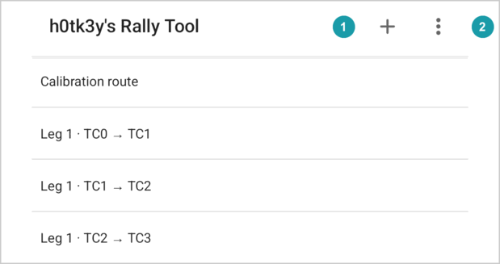

In the top bar:

- **+**  creates a new section.
- The menu (three dots)  holds:
  - **Driver HUD**: turns this device into the driver's screen. See [The driver's screen](#11-the-drivers-screen-driver-hud).
  - **Import section**: creates a section from text. See [Importing a section](#18-importing-a-section).
  - **Settings**.

You cannot delete a section from this list. Open it and use its menu (see [The section menu](#52-the-section-menu)).

### 4.1 Create a section

The **Create section** window has these fields:

| Field | What to type |
|---|---|
| **New section name** | Any name. Two sections cannot have the same name. |
| **Distance** | The length of the section in km, for example `60.0`. |
| **Time HH:MM(:SS)** | How long the section should take. |
| **Average speed** | The set average speed in km/h. |
| **Start at HH:MM(:SS)** | The time of day of the start. You may leave it empty, and then you will be able to start at any exact second by pressing **Now**. |

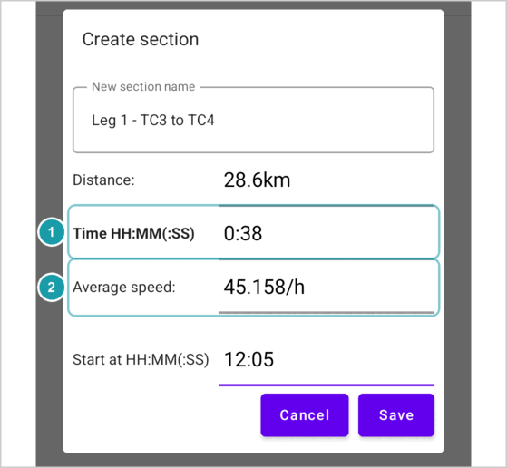

> [!NOTE]
> You type either the time or the speed, and the app calculates the other from the distance. The label of the field you typed in last turns bold : the app uses that value and calculates the other one . For example, type the distance `30`, then the speed `60`: the time becomes 30 minutes. If you then type the time `0.40`, the time label turns bold and the speed becomes 45.

> [!NOTE]
> An empty field uses the grey example value shown in it: 60.0 km, 01:00 (one hour) and 60 km/h. So if you leave the distance empty, the section is 60 km long.

**How to type a time.** If your keyboard does not have `:`, you can use `-` or `.` as an equivalent separator between the hours, minutes, and optionally seconds:

- `1:30` means 1 hour 30 minutes.
- `0.45` means 45 minutes.
- `10-05-30` is equivalent to 10:05:30.

Minutes are whole numbers, so `1.5` means 1 hour 5 minutes, not 1 hour 30 minutes, and `0.4` means 4 minutes, not 40. A number with no separator, such as `45`, is wrong: the field gets a red line under it.

Tap **Save**. The new section has two positions:

- the start, at 0.0 km, with the average speed (and the start time, if you typed one);
- the end, at the distance you typed.

The app then opens the section.

You can also create a section from text, for example one copied on another device: see [Importing a section](#18-importing-a-section).

---

## 5. The section screen

The section screen shows the roadmap as a list, one row per position. At the top are the section name, the **Edit** button  and the menu. The **Race mode** button  turns [race mode](#6-race-mode) on.

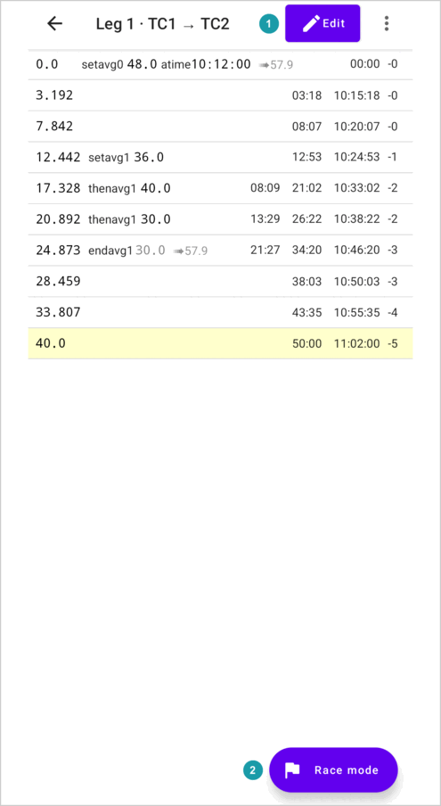

### 5.1 What a row shows

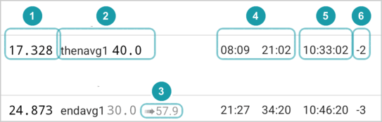

From left to right:

-  **The distance** in km.
-  **The marks:**
  - `setavg` and a speed: a set average speed starts here.
  - `thenavg` and a speed: the set average speed changes here.
  - After either of these, a percentage and **%**, if the speed is a percentage of a base speed.
  - `endavg`: a set average speed ends here. After it, in grey, the app shows the speed that ends.
  - `atime` and a time of day.
-  **➠ and a speed** in grey, for example `➠75.0`. This is the speed to drive on the rest of a stretch, outside its inner stretches. See [The ➠ speed](#146-the--speed).
- **Warnings** in red, for example `🚫late by 10:00` (not in the picture). See [Errors and warnings](#17-errors-and-warnings).
-  **The times**, in minutes and seconds from a start, for example `18:00` or `10:00 18:00`. These are not times of day: `18:00` means 18 minutes, and `90:00` means 1 hour 30 minutes. See [Several times on one row](#144-several-times-on-one-row) for what each time means.
-  **The time of day**, with hours, minutes and seconds, for example `10:18:00`, if a position in the section has a time of day (`atime`).
-  **The allowance**, such as `-1`, if you turned it on in Settings (see [Allowance](#8-allowance)).

> [!TIP]
> **Advanced.** The small number after `setavg`, `thenavg` or `endavg` (for example `setavg1` and `endavg1`) shows which marks belong together: a `setavg` and the `endavg` that ends it have the same number.

If the roadmap has an error, the app shows a red bar at the top, **Failed to calculate because of errors**, and no times at all. See [Errors and warnings](#17-errors-and-warnings).

**Selecting a row.** Tap a row to select it. It turns pale yellow. In race mode, you start from the selected row, and the panel shows how far you are from it.

The **Edit** button opens the editor. You do not need it for normal use; see [Editing positions](#15-editing-positions).

### 5.2 The section menu

The menu (three dots) holds:

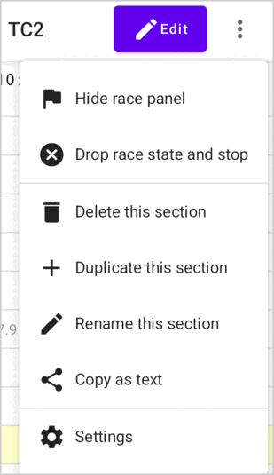

| Item | What it does |
|---|---|
| **Race mode** / **Show race panel** / **Hide race panel** / **Drop race state and stop** | You see **Race mode** when race mode is off: it turns race mode on. When race mode is on, you see **Hide race panel** (the clock keeps running) or **Show race panel** instead. When race mode is on and no timer runs (not started, or stopped), you also see **Drop race state and stop**: it ends race mode and clears the timers. |
| **Delete this section** | The first tap changes it to **Tap again to delete**. The second tap deletes the section. You cannot undo this. |
| **Duplicate this section** | Makes a copy under a new name and opens it. |
| **Rename this section** | Changes the name. |
| **Copy as text** | Copies the roadmap as text. You can paste it into a message, or into **Import section** on another device. |
| **Settings** | Opens Settings. Open Settings from here after you drive an odometer check route, so you can calibrate (see [Calibration](#102-calibration)). |

---

## 6. Race mode

Race mode is what you use in the car. It measures the distance you drive, shows how early or late you are, and records the road book into the roadmap as you go.

### 6.1 Turn race mode on

- On a phone, tap the round **Race mode** button at the bottom right.
- On a tablet, tap **Race mode** in the top bar.
- On any device, open the menu (three dots) and tap **Race mode**. This also closes the editor if it is open.

The first time, the app asks you to allow it to use your location, to find nearby devices (Bluetooth) and, on Android 14 and later, to show notifications. Allow all of them. If you refuse one, the app says **Please grant the required permissions** and does not start race mode.

The race panel then appears below the list (or beside it, if you turn the device sideways).

### 6.2 Race mode keeps running

Race mode keeps running when you lock the device, switch to another app, or go back to the section list. A notification shows its state, for example **Rally: In regularity** with the distance and the time. Tap it to go back to the app.

When you open the section again, the race panel opens by itself. If race mode runs in another section, the panel says **Race going in another section** and shows a **Go to section** button.

The screen stays on while a timer runs and the race panel is open. If you hide the race panel, the screen may turn off as usual.

> [!WARNING]
> Normally the app keeps running in the background. Some phones (for example Xiaomi, Huawei, or Samsung with its "deep sleeping apps") can close it by themselves to save battery. Race mode then starts again but forgets the timers. To prevent this, open the list of apps in the device's settings, choose this app, open **Battery**, and choose the option without limits (often called **Unrestricted**). Keep the device charged. Before the rally, test it: start a timer, lock the device for a while, and check that the timer still runs.

To hide the panel without stopping, use **Hide race panel** in the menu. To end race mode, first stop the timers (see below), then use **Drop race state and stop** in the menu.

### 6.3 What the race panel shows

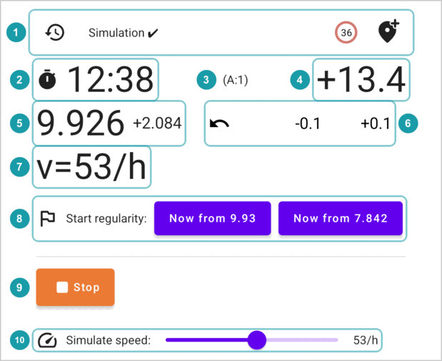

The buttons  are described in [Correcting the distance](#66-correcting-the-distance),  and  in [The race states](#65-the-race-states), and the slider  in [Measuring the distance](#9-measuring-the-distance).

**The toolbar** . A row of small buttons: the **Event log** (a clock with an arrow), the distance source (for example **GPS ✔**), the **v** button and **Add passed position** (a pin with a plus). On a phone held upright it is at the top of the race panel; on a tablet, or with the phone turned sideways, it is at the bottom, with bigger buttons:

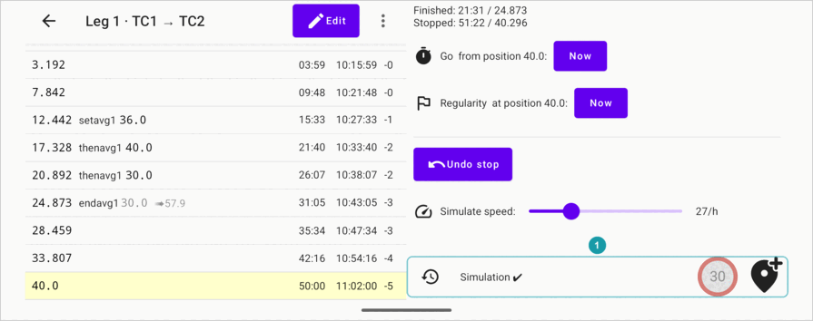

**The clock** . While the regularity timer runs, the time since the regularity start; otherwise, the time since the section start (see [The two timers](#64-the-two-timers-go-and-regularity)). It shows minutes and seconds, and from one hour on, hours too: `01:30:00`. (The rows show the same time as `90:00`.) Before the start time it counts down, with a minus.

**Early or late** . To the right of the clock. The app calculates the time you should have at your current distance, and compares it with the clock:

- `+5.3` means you are 5.3 seconds **late**;
- `-12.0` means you are 12 seconds **early**;
- from one minute on, it shows minutes and seconds: `+01:05`.

It does not show this value if the roadmap has errors.

**Allowance** . While the section timer runs, if you turned on an allowance in Settings, the panel shows `(A:N)`: how many minutes early you may be at your distance. The early/late value turns red when you are earlier than that. As long as it is not red, you are early within the allowance. See [Allowance](#8-allowance).

**The distance** . Your current distance in km. If a position is selected, a smaller number shows how far you are from it: `+0.125` means 125 m past it, `-0.300` means 300 m before it.

**The speed** . `v=` is your speed now. While the regularity timer runs, `ṽ=` is your average speed since the regularity started.

**Which time on a row to compare with the clock.** While the regularity timer runs, compare the clock with the time of the regularity's stretch on the row (see [Several times on one row](#144-several-times-on-one-row)): it is the first time on the row. The last time on the row is always the time from the section start.

**The countdown in the list.** While the regularity timer runs, the selected row counts down to its time of day: `-15` (seconds) or `-01:30`. When that time has passed, the countdown disappears.

**The green row.** While a timer runs, the list marks in green the last position you passed. To make the selection follow the car, tap the green row: the selection (yellow) then moves with you, and the list scrolls with it. Tap another row to stop this.

> [!NOTE]
> **What a minus means.**
>
> | Where | Example | Meaning |
> |---|---|---|
> | The clock | `-00:45` | 45 seconds until the start. |
> | Early/late | `-12.0` | 12 seconds early. |
> | Distance to the selected row | `-0.300` | 300 m before the selected position. |
> | Countdown in the list | `-15` | 15 seconds until the time of day of the selected row. |
> | Allowance in the list | `-2` | You may be up to 2 minutes early at this position. |

> [!NOTE]
> **What a plus means.**
>
> | Where | Example | Meaning |
> |---|---|---|
> | Early/late | `+5.3` | 5.3 seconds late. |
> | Distance to the selected row | `+0.125` | 125 m past the selected position. |

### 6.4 The two timers: Go and Regularity

The app has two timers. The panel shows only one of them at a time:

- The **section timer** (started from the **Go** row) times the **whole section** at its overall average speed (section length ÷ section time). Use it for a liaison with a target time. The panel shows a stopwatch icon.
- The **regularity timer** (started from the **Regularity** row) times a **regularity**, where each set average speed and each speed change counts. The panel shows a flag icon.

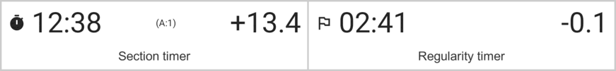

Both timers use the **device's clock**. Before the start, set the device's time by hand from the official rally clock.

**Which one to drive by.** The section timer's early/late value compares you with an even speed over the whole section. On a liaison with an allowance, drive by the section timer: as fast as you can, while its early/late value stays within the allowance (not red). In a regularity, drive by the regularity timer.

### 6.5 The race states

The panel looks different in each state:

| State | The panel shows | Buttons | Leads to |
|---|---|---|---|
| **Not started** | **Race not started** | the Go row, the Regularity row | section timer, or regularity timer |
| **Section timer runs** | clock, early/late, distance, speed | the **Start regularity:** row, **Undo finish regularity** (only after a regularity), **Stop** | regularity timer, or stopped |
| **Regularity timer runs** | clock, early/late, distance, speed and average speed, the speed buttons | **Finish regularity**, **Finish and start** | section timer, or a new regularity timer |
| **Stopped** | **Stopped:** with the time and the distance | the Go row, the Regularity row, **Undo stop** | section timer, or regularity timer |
| **In another section** | **Race going in another section** | **Go to section** | |

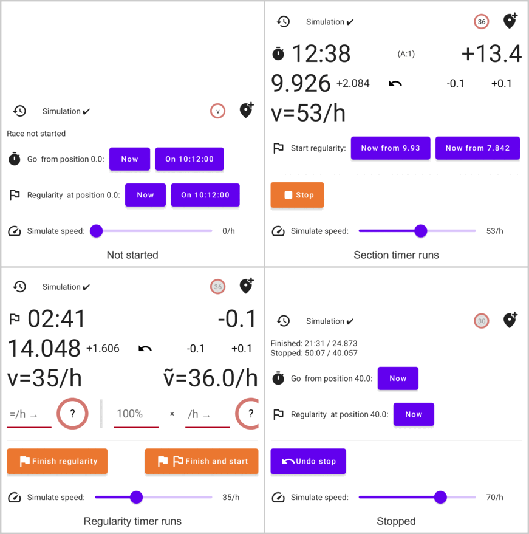

#### Starting: the Go row and the Regularity row

When nothing runs or after you stop, the panel shows two rows. First tap the position you want to start from in the list. The rows then show its distance: **Go from position 0.0:** and **Regularity at position 0.0:**.

Each row has these buttons:

| Button | What it does |
|---|---|
| **Now** | Starts the clock this second, at the selected position. Your distance is set to the distance of the position. |
| **On 10:00:00** | You see this if the selected position has a time of day. Starts the clock at that time of day. If that time is still to come, the clock counts down (with a minus) until then. Your distance is set to the distance of the position. The app counts the distance from the moment you tap, also during the countdown: if the car moves before the start, correct the distance at the start line. |
| **On 10:00:00, keep ODO** | You see this only after **Stop**. The same as **On 10:00:00**, but your distance does not change. Use it when you are already past the start point and the distance in the app is right. ("ODO" here means the distance the app measured.) |

The **Go** row starts the section timer. The **Regularity** row starts the regularity timer.

**The speed of a regularity.** When you start the regularity timer, the app gives the regularity a set average speed. It uses, in this order:

1. the remembered speed: the speed you tapped with the **v** button, or the last speed button you tapped in a regularity (see [Speed buttons](#67-speed-buttons-and-the-v-button));
2. the `setavg` on the selected position;
3. the speed of the roadmap at that point;
4. 60 km/h.

So before **each** regularity, tap the **v** button and tap its set speed. If the **v** button shows a speed that is wrong for this regularity, it would start with that speed.

#### While the section timer runs

The **Start regularity:** row (or **Next regularity:** after a regularity) starts a regularity timer:

| Button | What it does |
|---|---|
| **Now from _\<current distance\>_** | Starts a regularity now, from where you are. The number is your current distance. |
| **On 10:00:00 from _\<selected position\>_** | You see this if the selected position has a time of day. Starts the regularity at that time, from the selected position. Use it for a standing start with a given start time: add the start position with its `atime` in the editor (see [Editing positions](#15-editing-positions)), select it, and tap this button. |
| **On 10:00:00 from _\<selected position\>_, keep ODO** | The same, but your current distance (odometer) does not change. |
| **Now from _\<selected position\>_** | You see this if the selected position has no time of day and its distance differs from the app's distance. Starts a regularity now, from the selected position, and sets your distance to it. If the two distances are the same, the app shows only **Now from _\<current distance\>_**, which then does the same thing. |

During a "flying start", use the **first** button, **Now from _\<current distance\>_**, at the start point of a regularity. The other buttons start the regularity from the selected row: if the section start (0.0) is still selected, **On 10:00:00 from 0.000** would start the regularity from the section start.

Below them:

- **Undo finish regularity** (only after you finished a regularity) brings back the regularity you just finished, as if you had not finished it.
- **Stop** stops the section and measurements. The panel then shows **Stopped:** with the time and the distance.

#### While the regularity timer runs

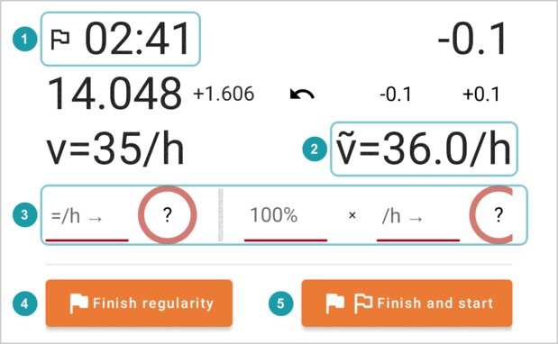

The flag  shows that the regularity timer runs, and `ṽ=`  is your average speed in the regularity. The row of speed fields and buttons  is described in [Speed buttons](#67-speed-buttons-and-the-v-button).

- **Finish regularity**  ends the regularity timer. The panel goes back to the section timer and shows **Finished:** with the regularity time and distance.
- **Finish and start**  ends the regularity and immediately starts a new one from where you are. Use it for chained regularities, for example at an intermediate finish where the next regularity starts at once. You cannot undo this.

The regularity timer does not end by itself, even after the last position: tap **Finish regularity**.

After **Finish regularity**, the section timer runs on. The panel shows the finished regularity , the **Next regularity:** row  for a later regularity, and **Undo finish regularity** :

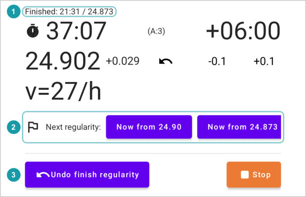

#### After Stop

- **Undo stop** brings back the section timer, as if you had not stopped.
- The Go row and the Regularity row let you start again.

### 6.6 Correcting the distance

The measured distance is never perfect. Correct it at known points, for example at a road-book point with an exact distance:

- **-0.1** and **+0.1** change the distance by 100 m.
- The device's **volume buttons** change it by 10 m (up adds, down subtracts). They work only while the race panel is open and a timer runs.
- **Tap the distance** to type the exact value. Tap **✓** to use it, or **✕** to cancel. If a position is selected, the button **Set to position 12.345** sets the distance to that position.

  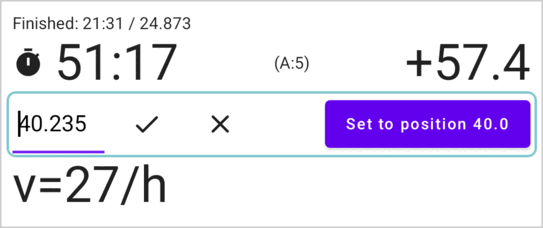

**Distances inside a regularity.** The app counts the distance from the section start, also in a regularity. If the road book counts from the regularity start instead, select the regularity's start row (with `setavg`): the panel then shows how far you are from it.

**Going backwards.** If you miss a turn and drive back, tap the **↶** button (Switch direction). It turns red, and the distance now goes down as you drive. Tap it again when you drive forward again.

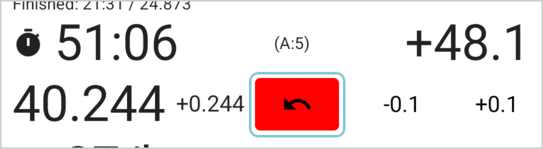

While you drive back in a regularity, the app removes every `thenavg` mark at the points you drive back over (but not before the start of the regularity). When you drive forward again, tap the speed buttons again at the speed changes. If sounds are on, the app beeps every 3 seconds while the distance goes backwards.

### 6.7 Speed buttons and the "v" button

While the regularity timer runs, the panel shows a row of round speed buttons: **5, 10, 20, 30 … 110**. When the set speed changes (at a point in the road book, or at a sign on the road), tap the new speed. The app:

- adds a position at your current distance with `thenavg` and that speed, so the times from here use the new speed;
- remembers this speed.

On a phone the row does not fit on the screen: swipe it sideways to see all the speed buttons  and the fields before them.

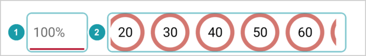

More fields in that row:

- **The percentage field**  (with **×** after it). Some rallies set the speed as a percentage of the speed limit on the road signs, for example "speed limit times 80%". Type `80` here. Then tap the speed limit you see on the sign, for example **60**: the app uses 60 × 80% = 48 km/h.
- **The "/h →" field and its button**: type any speed, then tap the round button next to it. It also uses the percentage.
- **The "=/h →" field and its button**: type an exact speed. This one does not use the percentage.

If you tap the wrong speed, tap the right one straight after: it adds another position with the right speed. Between the two taps the app used the wrong speed, so the times are a little off; the sooner you correct it, the smaller the error. Later, you can delete the wrong position in the editor (see [When to use the editor](#151-when-to-use-the-editor)).

**The "v" button** in the toolbar opens the same row when no regularity timer runs. There, a speed is only **remembered**: the next regularity timer starts with it as its `setavg`. Use it to set the speed of a regularity before it starts. **✕**  forgets it. The button  shows the remembered speed (for example **36**), and the percentage next to it if it is not 100%. Here the speed 36 was typed into the "=/h →" field and applied with its round button :

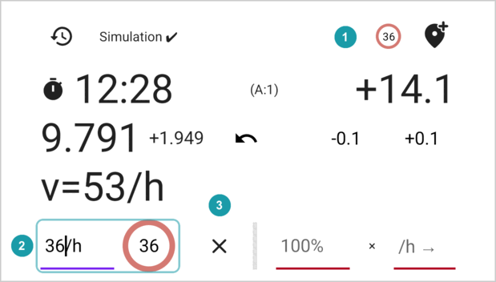

### 6.8 Adding a position as you pass it

The **Add passed position** button (a pin with a plus, in the toolbar) adds a position at your current distance. Use it to add each road-book point as you pass it: many of them have no distance in the road book, and the app then shows it. Select the position you just added, and the panel shows how far you have driven from it, which helps when the road book gives the distance to the next point. It works while a timer runs, and after **Stop**.

### 6.9 Event log

The **Event log** button (a clock with an arrow, in the toolbar) opens a list of what happened in this section: when the section timer and the regularity timers started and finished, and each undo. Each line shows the distance and the time of day. Finished timers also show how long they ran. The log stays when the app closes.

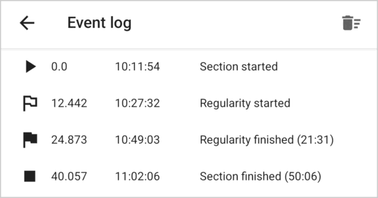

The bin button (**Delete events**) deletes the whole log immediately, without asking.

### 6.10 Sounds

Turn sounds on in Settings (**Play sounds on race mode actions**). The app then beeps:

- when a timer starts;
- when a regularity finishes, and when you stop;
- when it adds a position (with **Add passed position** or a speed button);
- when you switch to driving backwards, and every 3 seconds after that, until you drive forward again.

---

## 7. A rally day with the app

### 7.1 Before the rally

- If you use a reader in the car (OBD), set it up in Settings (see [Telemetry source](#101-telemetry-source)) and calibrate it, usually the day before: the organisers publish the calibration route in advance. Drive it and set the calibration factor (see [Calibration](#102-calibration)). The factor stays in Settings until you change it.
- Learn the app with the **Simulation** distance source (see [Measuring the distance](#9-measuring-the-distance)), or with a driving game (**OutGauge**).
- If the driver uses a second device, set it up (see [The driver's screen](#11-the-drivers-screen-driver-hud)).

### 7.2 When you get the road book

In a regularity rally you get the road book only shortly before the start. The app needs very little from it:

1. Make one section for each part of the road book that starts at a given time of day, for example from one time control to the next (see [Create a section](#41-create-a-section)). Type its length, its time or average speed, and its start time.
2. If you know where a regularity starts, you can add its start position to the section (see [Editing positions](#15-editing-positions)).

Everything else (where each regularity starts and ends, and where its speed changes) you record in race mode as you drive.

### 7.3 Before the start

- Set the device's time by hand from the official clock.
- Let the app run without battery limits, and connect the device to power.
- Turn race mode on, and check the distance source in the toolbar of the race panel (for example **GPS ✔**). See [Measuring the distance](#9-measuring-the-distance).
- If the driver uses a second device, check that it shows **Data ✔**.

### 7.4 At the start

Select the start position (0.0). Tap **On 10:00:00** in the **Go** row. The clock counts down to the start . The early/late value  is red until the start: at this moment you are early.

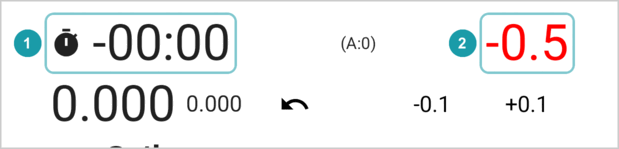

If the marshal gives you a different minute, tap **Stop** (this also works during the countdown), and then tap **Now** in the Go row at the moment you start.

### 7.5 A regularity inside a liaison

1. Before the regularity, tap the **v** button and tap its set speed.
2. At the start point of the regularity, tap the first button of the **Start regularity:** row, **Now from …** with your current distance. If the regularity has its own start time, tap it at that exact second. Then correct the distance to the start point, if needed.
3. At each change of the set speed, tap the new speed.
4. At the end of the regularity, tap **Finish regularity**. The section timer keeps running for the rest of the liaison. From here, drive by the section timer: as fast as you can, while its early/late value is not red.
5. At the end of the liaison, tap **Stop**.

### 7.6 Moving to the next section

Race mode times one section at a time. At the end of a section:

1. Tap **Finish regularity** (if a regularity timer runs), then **Stop**.
2. Go back to the section list and open the next section.
3. Select the start position and start as in [At the start](#74-at-the-start).

Do this while you wait at the time control, before your next start time.

### 7.7 On the road

- **Known points.** When you pass a point with an exact distance in the road book, correct the distance (see [Correcting the distance](#66-correcting-the-distance)).
- **Secret checks.** A secret time check can be anywhere on the road. On a liaison with an allowance, do not drive faster than the allowance lets you: as long as the early/late value of the section timer is not red, a secret check is safe.
- **Mistakes.** For a wrong turn, use **↶** (see [Correcting the distance](#66-correcting-the-distance)). For a wrong speed button, see [Speed buttons](#67-speed-buttons-and-the-v-button). If you tapped **Finish regularity** too early, tap **Undo finish regularity**. If you tapped **Stop** too early, tap **Undo stop**.

### 7.8 After the stage

- Open the **Event log** to see when each timer started and finished, and how long it ran.
- The section now holds the regularities you drove. You can keep it to look at later, or delete it.

---

## 8. Allowance

Some rallies let you arrive early at secret time checks on a liaison, by a number of minutes that grows with the time from the section start: the allowance. Within it, being early costs you nothing. Turn it on in Settings, under **Allowance**:

| Setting | Rule | Examples |
|---|---|---|
| **None** | No allowance. | |
| **⌊t/10⌋** | The time in minutes divided by 10, **rounded down**: one minute for each full 10 minutes. | 9 min → 0; 10 min → 1; 11 min → 1 |
| **⌈t/10⌉** | The time in minutes divided by 10, **rounded up**: one minute for each 10 minutes or part of 10 minutes. | 9 min → 1; 10 min → 1; 11 min → 2 |

The app uses the time from the start of the section (the last time on the row). It shows the allowance as `-N` at the end of the row: `-2` means that at this position you may be up to 2 minutes early. It does not show it while a regularity timer runs.

While the section timer runs, the race panel shows the allowance as `(A:N)` next to the early/late value. That value turns red when you are **early** by more than N minutes, that is, earlier than the allowance lets you be. See [What the race panel shows](#63-what-the-race-panel-shows).

---

## 9. Measuring the distance

Choose the source in Settings, under **Telemetry source**. You can change it while you drive.

| Source | How it works |
|---|---|
| **GPS** | Uses the device's location. You need nothing else. It works best with a clear view of the sky. Calibration does not change the GPS distance. |
| **OBD over Bluetooth** | Reads the car's speed from an ELM327 (OBD) reader that you plug into the car's diagnostic socket, usually under the dashboard. The app adds up the distance from the speed. Pair the reader with the device first: plug it in, turn on the ignition, and choose the reader in the device's Bluetooth settings. |
| **OutGauge** | Receives the speed from a driving game on a computer (for example BeamNG) over Wi-Fi. For training at home. Calibration does not change it. |
| **Simulation** | A **Simulate speed:** slider in the race panel sets the speed from 0 to 100 km/h. This is the best way to learn how the app works and to get used to it before the rally. |

The race panel shows the state of the source in its toolbar. Tap it to open Settings. Orange text means a problem.

| Text | Meaning |
|---|---|
| **GPS ✔ (9 sat)** | Good GPS signal, from 9 satellites. |
| **GPS ± (5 sat)** | Weak GPS signal. The app adds up the distance from the speed instead of the location. |
| **GPS: no position (3 sat)** | No usable GPS signal. The speed shows as 0. |
| **GPS: waiting (0 sat)** | Waiting for the first GPS signal. If this stays for long, check that the app may use your location. |
| **OBD: connecting…** | Connecting to the reader in the car. |
| **OBD ✔** | The reader works. |
| **OBD: permissions!** | The app may not use Bluetooth. Allow it in the device's settings. |
| **OBD: no MAC!** | No reader is chosen in Settings. |
| **OutGauge: waiting…** | Waiting for data from the game. |
| **OutGauge ✔** | Data from the game arrives. |
| **OutGauge: delayed** | No data for 2 seconds. The speed shows as 0. |
| **OutGauge: error** | The app cannot receive data, for example because another app uses the same port. |
| **Simulation ✔** | The simulation slider is on. |
| **Telemetry not initialized** | No source is running yet. |

How the app treats GPS: it ignores very bad signals. When the signal is weak, it uses the speed. While the car stands still, the GPS location still moves a little; so that this does not add distance, the app stops adding distance when the car has not moved for 3 seconds. ("sat" in the texts above means satellites.)

---

## 10. Settings

The app saves each setting immediately, except the calibration factor, which has its own **Save** button.

### 10.1 Telemetry source

See [Measuring the distance](#9-measuring-the-distance).

- With **OBD over Bluetooth**, first pair the ELM327 reader with the device (see [Measuring the distance](#9-measuring-the-distance)). Then tap the button  on the right of the **Bluetooth MAC address** field  and choose the reader from the list. The calibration factor  is described below.

  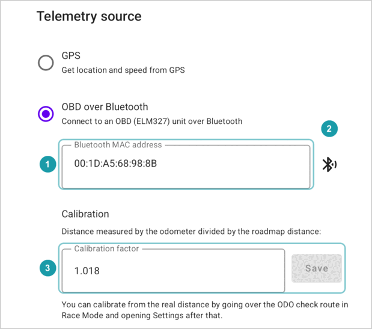
- With **OutGauge**, type the **UDP port** (a number from 1024 to 65535; 4444 if you do not change it). In the game, set the same port and this device's address, which the app shows below the field.

### 10.2 Calibration

The car measures distance a little differently from the road book. The **calibration factor** describes the difference:

> calibration factor = distance the car measures ÷ distance in the road book

For example, if the road book says 10.00 km and the car measures 10.20 km, the factor is 1.02. The app divides the speed from the reader by this factor. It applies only to **OBD over Bluetooth**: it does not change the GPS distance or the speed from a driving game. The calibration fields appear in Settings only when the source is **OBD over Bluetooth**.

**To calibrate on an odometer check route** (with **OBD over Bluetooth** as the source):

1. Make a section for the check route, starting at 0.0.
2. At the start of the route, turn race mode on, select the 0.0 position and tap **Now** in the Go row.
3. Drive the route, and stop the car at its end. You may tap **Stop**, but do not use **Drop race state and stop** before you calibrate.
4. Open **Settings** from the section menu (three dots), or tap the distance source text in the toolbar of the race panel. Do not open it from the section list. Settings now shows **Odometer distance:**. In this field, "odometer" means the distance the app measured from the reader, not the car's dashboard.
5. Type the exact distance of the check route in **Exact ODO check distance**. The app fills in the calibration factor. The factor you had before does not matter: the app takes it into account.
6. Tap **Save**.

### 10.3 Send data to the driver's device

Type the address of the driver's device in **The driver's device IP address**. See [The driver's screen](#11-the-drivers-screen-driver-hud).

### 10.4 Allowance

See [Allowance](#8-allowance).

### 10.5 Race mode

**Play sounds on race mode actions** turns the beeps on or off. See [Sounds](#610-sounds).

---

## 11. The driver's screen (Driver HUD)

A second device can show the driver the same list and race panel as you see, but without any buttons. ("HUD" means "head-up display": a display for the driver.) Both devices must be on the same Wi-Fi network. In the car, you can make one: turn on the mobile hotspot on your phone (in the phone's settings, under network or connections; it shares your internet over Wi-Fi), and connect the driver's device to it.

**On the driver's device:**

1. On the section list, open the menu and choose **Driver HUD**. The driver's device does not need any sections.
2. The screen shows this device's network address: numbers like **• 192.168.1.23 (Wi-Fi)**. Tap it to copy it.

**On your device:**

1. Open **Settings**, and type that address in **The driver's device IP address**. The address can change from day to day, so check it before each rally.
2. Turn race mode on in a section.

The driver's device now shows:

- the section and its positions, with your selected row and the green row;
- the race panel: the clock, early/late, the distance, the distance to the selected row, the speed;
- the countdown on the selected row.

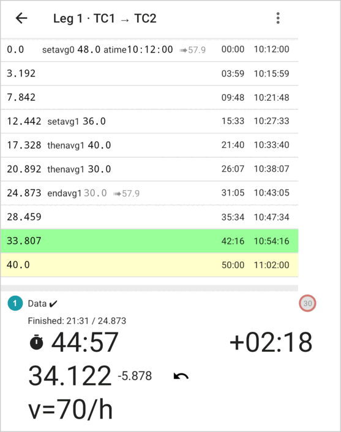

The driver's device does not show the allowance, and has no buttons to change anything. The state of the link  shows above the panel:

| Text | Meaning |
|---|---|
| **Data: waiting** | No data yet. Check the address, the Wi-Fi, and that race mode is on on your device. |
| **Data ✔** | Data arrives. |
| **Data ???** | No new data for more than a second. |
| **Data: incompatible version** | The two devices have different versions of the app. Install the same version on both. |

Leave the Driver HUD screen to stop it.

---

## 12. Saving, copying and sharing

- The app saves every change immediately.
- **Copy as text** copies the roadmap, so you can send it in a message. On another device, use **Import section** to make a section from it (see [Importing a section](#18-importing-a-section)).
- **Duplicate this section** makes a copy. Give it a new name: two sections cannot have the same name.

---

## 13. Questions and problems

**The times are gone and the screen shows a red bar.**
The roadmap has an error, usually from a change in the editor. Look for red messages on the rows, and see [Errors and warnings](#17-errors-and-warnings).

**The times on the rows changed when I opened the race panel.**
With the race panel open and no regularity timer running, the list shows section times. See [Section times in race mode](#148-section-times-in-race-mode).

**I cannot type a colon when I create a section.**
Use `-` or `.` instead: `1-30` or `1.30` for 1 hour 30 minutes. See [Create a section](#41-create-a-section).

**The time of day I typed is gone.**
Starting a timer with **Now** replaces it with the moment you tapped. **On…** keeps it. A regularity started with **Now** moves the time of day to the regularity's start position; **Finish regularity** gives the section start its start time back. See [How race mode builds your roadmap](#16-how-race-mode-builds-your-roadmap).

**The regularity started with the wrong speed.**
The regularity used the remembered speed of the **v** button. Tap the right speed in the row of speed buttons straight away, or correct the speed in the list of positions with the editor, right away or later, when you have time. Before the next regularity, set its speed with the **v** button. See [The speed of a regularity](#65-the-race-states).

**The early/late value does not show.**
The roadmap has errors. Correct the roadmap first.

**The distance does not grow.**
Check the distance source in the race panel (see [Measuring the distance](#9-measuring-the-distance)). For GPS, wait for **GPS ✔**. For OBD, check the reader in Settings and that it has power.

**The volume buttons change the volume instead of the distance.**
They change the distance only while the race panel is open and a timer runs. After you type in a field of the race panel, they may change the volume again.

**The driver's device says "Data: waiting".**
Check that both devices are on the same Wi-Fi, that the address on your device is right, and that race mode is on on your device. If it says **Data: incompatible version**, install the same version of the app on both devices.

**I started at the wrong position.**
There is no undo for a start. After the section timer starts, tap **Stop**, select the right position, and start again. In a regularity, tap **Finish regularity**, then start a new regularity from the right position. Afterwards, check the positions: race mode added marks for the wrong start (see [How race mode builds your roadmap](#16-how-race-mode-builds-your-roadmap)). If they overlap the part of the road you then drove for real, delete them in the editor, or they break the roadmap.

---

## Advanced topics

The rest of this guide explains how the app calculates the times, how to change the roadmap by hand, how race mode records the road book, and what the errors mean. You do not need it to use race mode.

## 14. How the app calculates the times

This chapter explains how the app turns the roadmap into times. It helps you read the rows and check that the app recorded the road book right.

### 14.1 The marks

- **Distance.** The distance from the start of the section, in km, with up to three decimals: `12.345`. The app keeps the positions in order of distance. Two positions may have the same distance.
- **`setavg 60`**: from here, the set average speed is 60 km/h. If another stretch is still open, this starts an inner stretch.
- **`thenavg 40`**: from here, the set average speed is 40 km/h. The clock of the stretch keeps running; only the speed changes.
- **`endavg`**: the stretch that started most recently and is still open ends here. The last stretch of a section does not need an `endavg`: it runs to the last position.
- **Percentage.** Some rallies give speeds as a percentage of a base speed, usually below 100%, for example "the speed limit on the road signs, times 80%". The app shows such a speed as the base speed and the percentage: `60.0 80 %`. The real speed is 60 × 80% = 48 km/h.
- **`atime 10:00:00`**: at this position, the rally clock shows 10:00:00. A section has only one time of day.

### 14.2 One average speed

The simplest roadmap has one `setavg`:

```
0.0   setavg 60
30.0
90.0
```

At 60 km/h, 1 km takes 1 minute. So the times are:

| Position | Time |
|---|---|
| 0.0 | 00:00 |
| 30.0 | 30:00 |
| 90.0 | 90:00 |

Times are minutes and seconds from the start. Minutes can go above 59: `90:00` means 1 hour 30 minutes.

**Changing the speed with `thenavg`.** The clock keeps running when the speed changes:

```
0.0   setavg 60
10.0  thenavg 30
20.0  endavg
```

| Position | Time | Why |
|---|---|---|
| 0.0 | 00:00 | |
| 10.0 | 10:00 | 10 km at 60 km/h |
| 20.0 | 30:00 | then 10 km at 30 km/h takes 20 more minutes |

### 14.3 Inner stretches

An inner stretch is a stretch with its own speed inside a longer stretch whose total time stays fixed. The typical case: a regularity inside a liaison. Race mode records it for you (see [How race mode builds your roadmap](#16-how-race-mode-builds-your-roadmap)): `setavg` at the start of the regularity, `endavg` at its end.

```
0.0   setavg 60
10.0  setavg 30
15.0  endavg
30.0
```

This means:

- The **liaison** is 0.0 to 30.0 at 60 km/h. The whole 30 km must take **30 minutes**.
- The **regularity** (the inner stretch) is 10.0 to 15.0 at 30 km/h. These 5 km must take **10 minutes**.
- That leaves **20 minutes** for the other **25 km**. So you must drive those 25 km at 25 ÷ 20 × 60 = **75 km/h**.

The app shows:

| Position | Times | ➠ |
|---|---|---|
| 0.0 `setavg 60` | 00:00 | ➠75.0 |
| 10.0 `setavg 30` | 08:00 | |
| 15.0 `endavg` | 10:00 18:00 | ➠75.0 |
| 30.0 | 30:00 | |

How to read this:

- At 0.0 the app tells you to drive at 75 km/h (➠75.0) until the regularity starts.
- You reach 10.0 at 08:00 (10 km at 75 km/h).
- The regularity takes 10:00, so you reach 15.0 at 18:00 from the start.
- At 15.0 the app again tells you to drive at 75 km/h until the end.
- You reach 30.0 at 30:00, which is the time of the whole liaison at 60 km/h.

Compare this with `thenavg`: with `thenavg 30` at 10.0 and `thenavg 60` at 15.0, each part simply takes the time of its own speed, and the total grows to 10 + 10 + 15 = 35 minutes.

**The pattern `setavg` – `thenavg` – `endavg`.** When the set speed changes inside the regularity, race mode adds a `thenavg`. The clock of the regularity keeps running:

```
0.0   setavg 60
10.0  setavg 30
15.0  thenavg 90
24.0  endavg
30.0
```

- The regularity is 10.0 to 24.0: 5 km at 30 km/h (10 minutes), then 9 km at 90 km/h (6 minutes). That is 16 minutes.
- The liaison still takes 30 minutes in total. That leaves 14 minutes for the other 16 km (0.0 to 10.0 and 24.0 to 30.0), so the ➠ speed is 16 ÷ 14 × 60 = 68.6 km/h.

The rows show:

| Position | Times | ➠ |
|---|---|---|
| 0.0 `setavg 60` | 00:00 | ➠68.6 |
| 10.0 `setavg 30` | 08:45 | |
| 15.0 `thenavg 90` | 10:00 18:45 | |
| 24.0 `endavg` | 16:00 24:45 | ➠68.6 |
| 30.0 | 30:00 | |

An inner stretch can lie inside another inner stretch. The app calculates each level in the same way.

### 14.4 Several times on one row

A position inside an inner stretch shows one time for each stretch it lies in, from left to right:

1. the time from the start of the smallest stretch around it;
2. the time from the start of the next, larger stretch;
3. … and so on;
4. last, the time from the start of the section.

So in `10:00 18:00`, `10:00` is the time from the start of the regularity, and `18:00` is the time from the start of the section.

If a position in the section has a time of day, the row then shows the time of day at this position, for example `10:18:00` (see [Time of day](#147-time-of-day)).

The position where an inner stretch starts (with `setavg`) shows only the times of the larger stretches around it, not its own 00:00. (Stretches that follow one another, as in the next part, are different: each one starts at 00:00.)

### 14.5 One stretch after another

A roadmap can also end a stretch and start a new one at the same distance, each with its own time: two positions with the same distance, `endavg` first:

```
0.0   setavg 60
5.0
10.0  endavg
10.0  setavg 30
15.0
20.0  endavg
```

The app treats the whole section as one stretch that holds the two stretches. The rows show:

| Position | Times |
|---|---|
| 0.0 `setavg 60` | 00:00 |
| 5.0 | 05:00 |
| 10.0 `endavg` | 10:00 |
| 10.0 `setavg 30` | 00:00 10:00 |
| 15.0 | 10:00 20:00 |
| 20.0 `endavg` | 20:00 30:00 |

In the second stretch, each row shows two times: the time in that stretch, and the time from the start of the section. Its `setavg` row shows 00:00, because a new stretch starts there. In the first stretch, the two times are the same, so the app shows only one.

The new `setavg` must be at exactly the same distance as the `endavg` before it. If there is a gap, the app shows the error `outer interval not covered by subs` (see [Errors and warnings](#17-errors-and-warnings)).

### 14.6 The ➠ speed

The grey **➠** value is the speed to drive on the parts of a stretch that are outside its inner stretches (see the example in [Inner stretches](#143-inner-stretches)). The app shows it:

- at the start of a stretch that has inner stretches, and
- at the end of each inner stretch: "from here, drive at this speed".

It does not show it at the last position of the section, or at a `thenavg` inside an inner stretch: there you stay inside the inner stretch, so the rest of the road does not start yet.

**How to use it.** In theory you hold the ➠ speed all the way. On a real road you cannot drive a long stretch at one even speed, so take the ➠ speed as a hint about the pace of the stretch. In practice, drive as fast as you can within the allowance (see [Allowance](#8-allowance)), and use the early/late value of the section timer to check that you are not too early.

If the inner stretches need more time than the whole longer stretch allows, the app cannot give a useful ➠ speed. It shows the warning `🚫late by` instead (see [Errors and warnings](#17-errors-and-warnings)).

### 14.7 Time of day

When one position has a time of day, the app calculates the time of day at each position **after** it: that time of day plus the time it takes to drive there.

For example, with `setavg 60` at 0.0 and `atime 10:00:00` at 10.0, the position at 20.0 shows `10:10:00`.

When the race panel is open and no regularity timer runs, the app also shows the time of day at the positions **before** the time of day, calculated from the overall average speed (see [Section times in race mode](#148-section-times-in-race-mode)).

After midnight the time of day starts again from 00:00:00. The app does not show the day.

### 14.8 Section times in race mode

When the race panel is open and no regularity timer runs, the list shows **section times** instead of the normal times. The app calculates section times as if you drove the whole section at its overall average speed, with no inner stretches:

> overall average speed = section length ÷ total time of the section

These are the times that the section timer uses. When a regularity timer starts, the list goes back to the normal times.

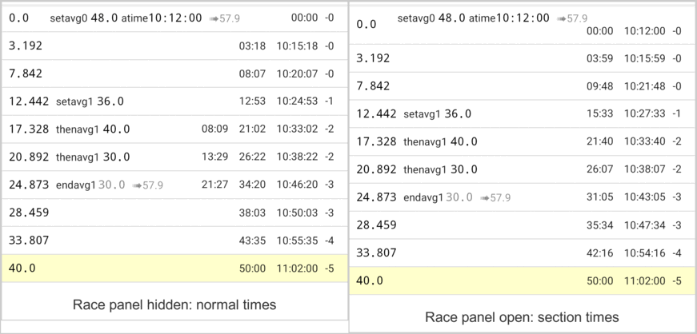

> [!NOTE]
> The icon next to the clock tells you which times you see. With the flag (the regularity timer runs), the rows show the normal times. With the stopwatch (only the section timer runs), and also before the start and after **Stop**, they show section times.

---

## 15. Editing positions

The editor lets you change the roadmap by hand. Use it with care: a wrong `setavg`, `thenavg` or `endavg` can break the calculation for the whole section, and then the early/late value disappears.

### 15.1 When to use the editor

You need the editor in these cases:

- **To fix a mistake during the rally.** For example, to delete a wrong speed change, or to correct a distance.
- **To prepare a known start.** For example, to add the start position of a regularity, with its time of day for a standing start.
- **For a quick calculation.** For example, to see what speed or time a stretch needs, outside race mode.

For everything else, create a section (see [Create a section](#41-create-a-section)) and drive it in race mode: race mode writes the marks for you.

**After every change, check the list.** Tap **Calculate**: if the red bar **Failed to calculate because of errors** appears, see [Errors and warnings](#17-errors-and-warnings) and fix the error before you drive on.

### 15.2 How the editor works

Tap **Edit**. A keypad  appears at the bottom of the screen, and the button changes to **Calculate** . The device's own keyboard does not appear. The app saves every change immediately; there is no Save button. While the editor is open, the app hides the times.

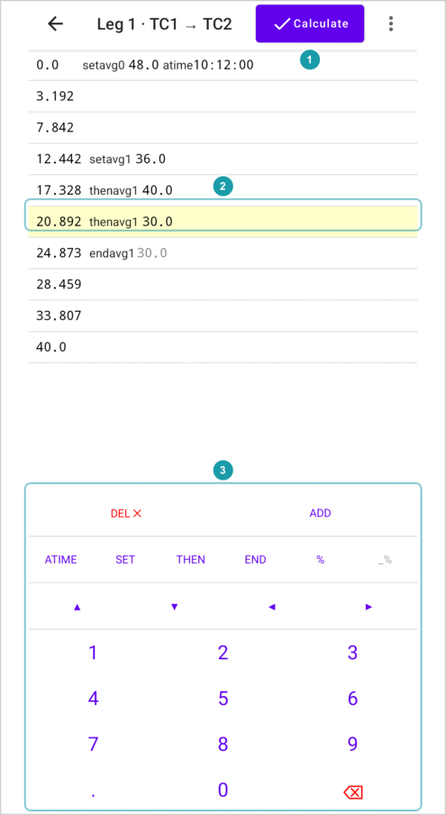

Tap a row to select it . Tap a value in the row (the distance, the speed, the percentage or the time of day) to start typing in it. A blinking line, the **cursor**, shows where your next digit goes.

You can open the editor while a timer runs in race mode. The keypad then takes the place of the race panel, and the timer keeps running. Tap **Calculate**, then **Show race panel** in the menu, to see the panel again.

### 15.3 The keys

| Key | What it does |
|---|---|
| **DEL ╳** | Deletes the selected position. The next position becomes selected. |
| **ADD** | Adds a new position at 0.0 km below the selected one. Type its distance; the row then moves to its place. Until you do, the app shows the error `<`, because 0.0 is smaller than the distance above it. |
| **ATIME** | Gives the position a time of day (00:00:00), ready for you to type. Press it again while you type in the time to remove it. A section can have only one time of day, so this removes it from the other positions. |
| **SET** | Makes the position a `setavg`, ready for you to type the speed. Press it again while you type in the speed or the percentage to remove it. |
| **THEN** | The same as **SET**, but for `thenavg`. |
| **END** | Makes the position an `endavg`, or removes the `endavg` if it has one. |
| **%** | Adds a percentage (100%) to the speed, ready for you to type. Press it again while you type in the percentage to remove it. Works only on a position with **SET** or **THEN**. |
| **_%** | Shows the last percentage you typed, for example **80%**. Press it to give the selected position that percentage. |
| **▲ ▼** | Select the position above or below. |
| **◀ ▶** | Move the cursor left or right. At the start or end of a value, they jump to the previous or next value in the row. |
| **0–9** | Type a digit at the cursor. |
| **.** | Puts the decimal point at the cursor. Works in a distance, a speed or a percentage, not in a time of day. |
| **⌫** | Deletes the digit to the left of the cursor. |

A position can have only one of `setavg`, `thenavg` and `endavg`. If you press **SET** on a `thenavg` position, it becomes a `setavg` with the same speed.

When you cannot use a key, the app shows it pale, and it does nothing. For example, **▲** is pale on the first position.

### 15.4 Typing a time of day

In a time of day, each digit replaces the digit under the cursor, and the cursor jumps over the colons. The app only lets you type a time that can exist: hours from 00 to 23, and minutes and seconds from 00 to 59. It shows pale the digits that would give a wrong time. **⌫** sets the digit to the left back to 0.

### 15.5 When a row moves

The list always stays in order of distance. When you change a distance, the row moves to its new place while you type, and stays selected. For example, if you change 3.0 to 39.0 by typing 9, the row jumps below 5.0. If you then press **⌫**, it moves back.

---

## 16. How race mode builds your roadmap

**Before a regularity**, while you still drive the liaison, set the regularity's starting speed with the **v** button (see [Speed buttons](#67-speed-buttons-and-the-v-button)). The regularity timer then starts with this speed.

The section you created holds only its start and its end. As you drive, race mode writes the rest:

| You tap | The app writes |
|---|---|
| **Now** in the Go or Regularity row | The start time as the time of day (`atime`) of the start position. |
| **On 10:00:00** | It uses the time of day that the selected position already has, and keeps it. (You see the **On…** buttons only when the selected position has a time of day.) |
| A **regularity** start | A `setavg` with the regularity's speed on the start position. Sometimes the app adds a new position at the start point for this. (A start with **Now** also writes the start time, as above.) |
| A speed button during a regularity | A new position at your distance, with `thenavg` and that speed. |
| **Finish regularity** | A new position at your distance, with an `endavg` that ends the regularity's stretch, unless the roadmap already ends it. Then the app gives the section start its start time back. |
| **Undo finish regularity** | It removes the position that **Finish regularity** added. |
| **Add passed position** | A new position at your distance, with no marks. |

> [!NOTE]
> While the regularity runs, it has no end yet, so the app treats it as going on to the end of the section. Until you tap **Finish regularity**, the times, the ➠ speeds and even a `🚫late by` warning after the regularity start can look wrong. They are right again after the finish.

So after a regularity inside a liaison, the roadmap holds an inner stretch: `setavg` at the regularity start, `thenavg` at each speed change, `endavg` at its end. The app then calculates the times for the rest of the liaison from it (see [Inner stretches](#143-inner-stretches)).

> [!NOTE]
> **Driving backwards** in a regularity removes **every** `thenavg` at the points you drive back over, also the ones you did not add in this regularity (see [Correcting the distance](#66-correcting-the-distance)).

---

## 17. Errors and warnings

When the roadmap has an error, the app cannot calculate the times. It shows **Failed to calculate because of errors** at the top , and a red message on each row with an error .

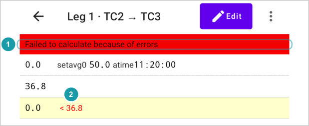

Race mode does not make these errors; they come from changes in the editor or from imported text.

| Message | What is wrong | How to fix it |
|---|---|---|
| `< 5.0` | This distance is smaller than an earlier one (5.0 here). | Correct the distance. This is the only error the app also shows in the editor. |
| `outside intervals` | This position is not inside any stretch: it comes before the first `setavg`, or after an `endavg` that ended the last open stretch. The app shows this on the position itself. (A `setavg` at the same distance as that `endavg` starts a new stretch, as in [One stretch after another](#145-one-stretch-after-another); that is not an error.) | Add a `setavg` before the position, or remove the `endavg` that ends the stretch too early. |
| `no setavg for this position` | This `endavg` has no open stretch to end. | Remove the `endavg`, or add the missing `setavg`. |
| `outer interval not covered by subs` | After a stretch ends, the next stretch starts at a different distance, so part of the section is not inside any stretch. The app shows this on the `endavg` before the gap. ("Subs" means the stretches inside the section.) | Put the next `setavg` at the same distance as the `endavg` before it, or remove the extra `endavg`. |

There is also one warning. It does not stop the calculation:

| Message | What it means |
|---|---|
| `🚫late by 10:00` | The inner stretches need more time than the whole longer stretch allows. Here they need 10 minutes more. Even with no time at all on the rest of the road, you cannot make it. The times in this stretch are not useful. Check the speeds and distances. |

A speed of 0 gives the time `∞`. This means the app cannot calculate a time.

---

## 18. Importing a section

**Import section** (in the menu of the section list) creates a section from text, for example text you copied with **Copy as text** on another device.

Type a name, and paste the text into **Section content**. If the text has a mistake, the field turns red, says **Invalid input**, and you cannot save.
