# 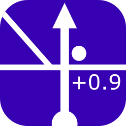 h0tk3y's Rally Tool: руководство пользователя

*[English version](user-guide.md)*

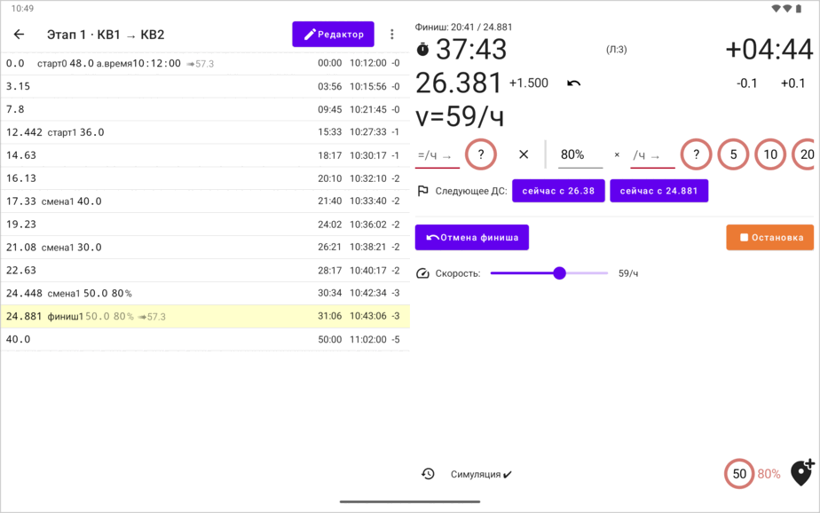

Это руководство для штурмана в ралли третьей категории (Р3К). Оно объясняет, как подготовить секцию, как работать с приложением в машине и как приложение считает время.

**Скачать:** приложение работает на Android. Скачайте `android-release.apk` из [последнего релиза на GitHub](https://github.com/h0tk3y/rally/releases/latest) и откройте его на телефоне или планшете, чтобы установить.

## Содержание

1. [Что делает приложение](#1-что-делает-приложение)
2. [Слова, которые используются в руководстве](#2-слова-которые-используются-в-руководстве)
3. [Быстрый старт](#3-быстрый-старт)
4. [Список секций](#4-список-секций)
   - [4.1 Создание секции](#41-создание-секции)
5. [Экран секции](#5-экран-секции)
   - [5.1 Что показывает строка](#51-что-показывает-строка)
   - [5.2 Меню секции](#52-меню-секции)
6. [Режим гонки](#6-режим-гонки)
   - [6.1 Как включить режим гонки](#61-как-включить-режим-гонки)
   - [6.2 Режим гонки продолжает работать](#62-режим-гонки-продолжает-работать)
   - [6.3 Что показывает панель гонки](#63-что-показывает-панель-гонки)
   - [6.4 Расстояние от выбранной позиции](#64-расстояние-от-выбранной-позиции)
   - [6.5 Два таймера: секция и ДС](#65-два-таймера-секция-и-дс)
   - [6.6 Состояния гонки](#66-состояния-гонки)
   - [6.7 Поправка дистанции](#67-поправка-дистанции)
   - [6.8 Кнопки скорости и кнопка «v»](#68-кнопки-скорости-и-кнопка-v)
   - [6.9 Добавление позиции на ходу](#69-добавление-позиции-на-ходу)
   - [6.10 История событий](#610-история-событий)
   - [6.11 Звуки](#611-звуки)
7. [День ралли с приложением](#7-день-ралли-с-приложением)
   - [7.1 Перед ралли](#71-перед-ралли)
   - [7.2 Когда вы получили дорожную книгу](#72-когда-вы-получили-дорожную-книгу)
   - [7.3 Перед стартом](#73-перед-стартом)
   - [7.4 На старте](#74-на-старте)
   - [7.5 ДС внутри дорожного участка](#75-дс-внутри-дорожного-участка)
   - [7.6 Переход к следующей секции](#76-переход-к-следующей-секции)
   - [7.7 На трассе](#77-на-трассе)
   - [7.8 После этапа](#78-после-этапа)
8. [Льгота](#8-льгота)
9. [Измерение дистанции](#9-измерение-дистанции)
10. [Настройки](#10-настройки)
    - [10.1 Источник телеметрии](#101-источник-телеметрии)
    - [10.2 Тарировка](#102-тарировка)
    - [10.3 Отправка данных на устройство пилота](#103-отправка-данных-на-устройство-пилота)
    - [10.4 Льгота](#104-льгота)
    - [10.5 Режим гонки](#105-режим-гонки)
    - [10.6 Работа в фоне](#106-работа-в-фоне)
11. [Экран пилота](#11-экран-пилота)
12. [Сохранение, копирование и обмен](#12-сохранение-копирование-и-обмен)
13. [Вопросы и проблемы](#13-вопросы-и-проблемы)

[Продвинутые сценарии](#продвинутые-сценарии):

14. [Как приложение считает время](#14-как-приложение-считает-время)
    - [14.1 Метки](#141-метки)
    - [14.2 Одна средняя скорость](#142-одна-средняя-скорость)
    - [14.3 Вложенные отрезки](#143-вложенные-отрезки)
    - [14.4 Несколько значений времени в строке](#144-несколько-значений-времени-в-строке)
    - [14.5 Отрезки друг за другом](#145-отрезки-друг-за-другом)
    - [14.6 Скорость ➠](#146-скорость-)
    - [14.7 Астрономическое время](#147-астрономическое-время)
    - [14.8 Время секции в режиме гонки](#148-время-секции-в-режиме-гонки)
15. [Редактирование позиций](#15-редактирование-позиций)
    - [15.1 Когда нужен редактор](#151-когда-нужен-редактор)
    - [15.2 Как работает редактор](#152-как-работает-редактор)
    - [15.3 Клавиши](#153-клавиши)
    - [15.4 Ввод астрономического времени](#154-ввод-астрономического-времени)
    - [15.5 Когда строка перемещается](#155-когда-строка-перемещается)
16. [Как режим гонки заполняет список позиций](#16-как-режим-гонки-заполняет-список-позиций)
17. [Ошибки и предупреждения](#17-ошибки-и-предупреждения)
18. [Импорт секции](#18-импорт-секции)

---

## 1. Что делает приложение

- **Ведёт время в машине.** В режиме гонки приложение показывает часы, пройденную дистанцию и на сколько секунд вы опережаете или отстаёте. Дистанцию оно измеряет по GPS, по машине через адаптер ELM327 (OBD) или берёт из автосимулятора для тренировки.
- **Записывает дорожную книгу по ходу движения.** Вы создаёте секцию, указав только её длину, среднюю скорость или норму времени и время старта. В машине вы нажимаете кнопку, когда начинается ДС, когда меняется заданная скорость и когда ДС заканчивается. Приложение записывает всё это в список точек секции, **список позиций**.
- **Показывает пилоту те же данные** на втором устройстве.

Список позиций можно менять и вручную, в редакторе. Это нужно, чтобы исправить ошибку или быстро что-то посчитать; см. [Редактирование позиций](#15-редактирование-позиций).

---

## 2. Слова, которые используются в руководстве

| Слово | Что оно значит в приложении |
|---|---|
| **Секция** | Часть ралли, по которой время ведётся целиком, например дорожный участок от одного КВ до следующего. В приложении может быть много секций. |
| **Позиция** | Одна строка секции: точка на дороге с дистанцией в километрах. У позиции могут быть метки. |
| **Список позиций** | Все позиции секции по порядку дистанции: копия вашей дорожной книги в приложении. |
| **Метка** | Дополнительные сведения о позиции. Приложение пишет метки коротко: «старт» (начинается заданная скорость), «смена» (заданная скорость меняется), «финиш» (заданная скорость заканчивается) и «а.время» (астрономическое время). |
| **Отрезок** | Часть дороги от точки, где начинается заданная скорость, до точки, где она заканчивается. |
| **Вложенный отрезок** | Отрезок со своей скоростью внутри более длинного отрезка. ДС внутри дорожного участка — это вложенный отрезок. |
| **Астрономическое время** | Время по часам ралли в позиции, например 10:00:00. В приложении — метка «а.время». |
| **Режим гонки** | Режим, в котором вы работаете в машине. Под списком появляется **панель гонки** с часами, дистанцией и опережением или отставанием. |
| **Таймер секции** | В режиме гонки — часы, которые ведут время всей секции по её общей средней скорости. Он запускается из ряда кнопок **Старт секции**. |
| **Таймер ДС** | В режиме гонки — часы, которые ведут время ДС, где учитывается каждая заданная скорость. Он запускается из ряда кнопок **Старт ДС**, а пока идёт таймер секции — из ряда **Старт ДС:**. |
| **Источник телеметрии** | Откуда приложение берёт дистанцию и скорость: GPS, адаптер в машине, автосимулятор или ползунок симуляции. |

---

## 3. Быстрый старт

**Установите приложение** из [последнего релиза](https://github.com/h0tk3y/rally/releases/latest) (файл `android-release.apk`). Если пилот пользуется [экраном пилота](#11-экран-пилота), установите приложение и на его устройство.

**Перед ралли, обычно накануне:** если вы пользуетесь адаптером в машине (OBD), настройте его (см. [Источник телеметрии](#101-источник-телеметрии)) и оттарируйте на тарировочном участке, который организаторы публикуют заранее (см. [Тарировка](#102-тарировка)). С GPS этот шаг не нужен.

**Когда вы получили дорожную книгу, прямо перед стартом:**

1. На первом экране нажмите **+** (Создать секцию; см. [Создание секции](#41-создание-секции)).
2. Введите имя, длину секции, среднюю скорость или норму времени и время старта (его вы рассчитываете для каждой секции). Нажмите **Сохранить**. Приложение откроет новую секцию.

Сделайте так для каждой секции ралли. Больше ничего готовить не нужно.

**В машине:**

3. Перед стартом нажмите **Режим гонки** и дайте приложению все разрешения, которые оно просит (см. [Как включить режим гонки](#61-как-включить-режим-гонки)).
4. Выберите в списке стартовую позицию (0.0). В ряду **Старт секции** на панели гонки нажмите **в 10:00:00** (время старта, которое вы ввели). Часы отсчитывают время до старта, а потом идут вперёд (см. [На старте](#74-на-старте)). (Если вы не указали время старта, кнопки **в…** нет: нажмите **сейчас** в ту секунду, когда стартуете.)
5. В пути следите за часами, дистанцией и опережением или отставанием (см. [Что показывает панель гонки](#63-что-показывает-панель-гонки)). Поправляйте дистанцию на известных точках кнопками **-0.1** и **+0.1** или кнопками громкости (см. [Поправка дистанции](#67-поправка-дистанции)).
6. **ДС.** До его начала нажмите кнопку **v** на панели гонки и выберите заданную скорость. В точке старта ДС нажмите первую кнопку ряда **Старт ДС:** — **сейчас с …** с вашей текущей дистанцией. Когда заданная скорость меняется, нажмите новую скорость в ряду кнопок скорости. В конце ДС нажмите **Финиш**. См. [ДС внутри дорожного участка](#75-дс-внутри-дорожного-участка) и [Кнопки скорости](#68-кнопки-скорости-и-кнопка-v).
7. В конце секции нажмите **Остановка** и переходите к следующей секции (см. [Переход к следующей секции](#76-переход-к-следующей-секции)).

Весь день по шагам описан в разделе [День ралли с приложением](#7-день-ралли-с-приложением).

---

## 4. Список секций

Это первый экран. На нём — имена всех ваших секций. Нажмите на имя, чтобы открыть секцию.

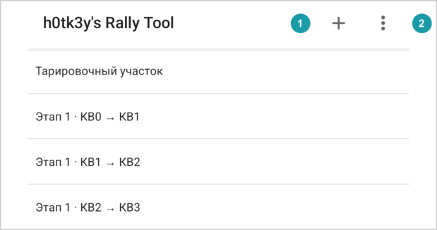

В заголовке:

- **+**  создаёт новую секцию.
- В меню (три точки) :
  - **Экран пилота**: превращает это устройство в экран для пилота. См. [Экран пилота](#11-экран-пилота).
  - **Импорт секции**: создаёт секцию из текста. См. [Импорт секции](#18-импорт-секции).
  - **Настройки**.

Удалить секцию из этого списка нельзя. Откройте её и воспользуйтесь её меню (см. [Меню секции](#52-меню-секции)).

### 4.1 Создание секции

В окне **Создать секцию** есть такие поля:

| Поле | Что ввести |
|---|---|
| **Имя секции** | Любое имя. У двух секций не может быть одинакового имени. |
| **Дистанция** | Длина секции в километрах, например `60.0`. |
| **Норма времени ЧЧ:ММ(:СС)** | За сколько нужно пройти секцию. |
| **Средняя скорость** | Заданная средняя скорость в км/ч. |
| **Время старта ЧЧ:ММ(:СС)** | Астрономическое время старта. Его можно не указывать: тогда вы сможете стартовать в любую секунду кнопкой **сейчас**. |

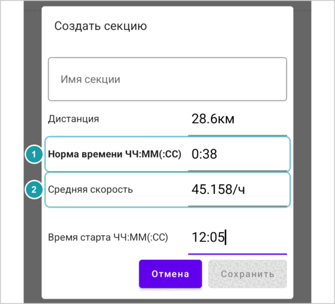

> [!NOTE]
> Вы вводите либо норму времени, либо скорость, а приложение считает второе по дистанции. Подпись поля, в которое вы вводили последним, становится жирной : приложение берёт это значение и вычисляет другое . Например, введите дистанцию `30`, потом скорость `60`: норма времени станет 30 минут. Если потом ввести норму времени `0.40`, жирной станет её подпись, а скорость станет 45.

> [!NOTE]
> Пустое поле берёт серое значение-пример, которое в нём показано: 60.0 км, 01:00 (один час) и 60 км/ч. Так, если оставить дистанцию пустой, длина секции будет 60 км.

**Как вводить время.** Если на клавиатуре нет `:`, вместо него можно ставить `-` или `.` между часами, минутами и, если нужно, секундами:

- `1:30` — 1 час 30 минут.
- `0.45` — 45 минут.
- `10-05-30` — то же, что 10:05:30.

Минуты — целые числа, поэтому `1.5` — это 1 час 5 минут, а не 1 час 30 минут, а `0.4` — это 4 минуты, а не 40. Число без разделителя, например `45`, — ошибка: поле подчёркивается красным.

Нажмите **Сохранить**. В новой секции две позиции:

- старт на 0.0 км со средней скоростью (и временем старта, если вы его ввели);
- финиш на введённой дистанции.

Затем приложение открывает секцию.

Секцию можно создать и из текста, например скопированного на другом устройстве: см. [Импорт секции](#18-импорт-секции).

---

## 5. Экран секции

Экран секции показывает список позиций, по одной строке на позицию. Наверху — имя секции, кнопка **Редактор**  и меню. Кнопка **Режим гонки**  включает [режим гонки](#6-режим-гонки).

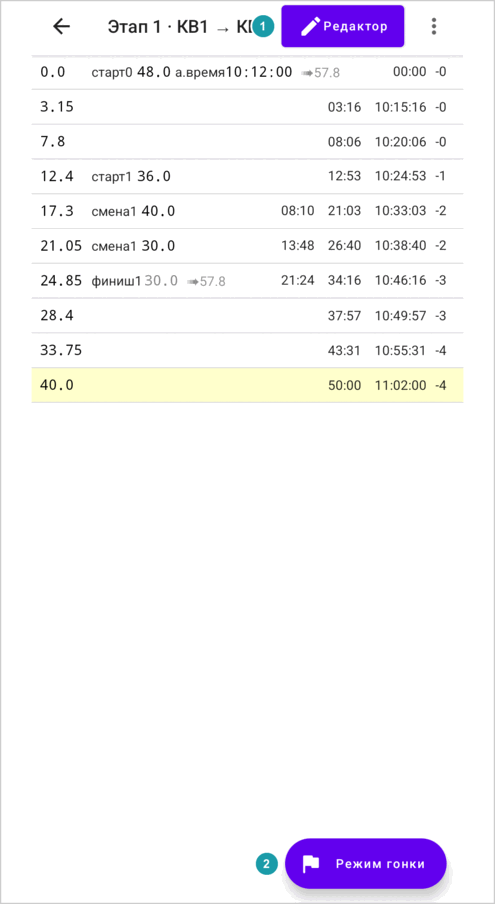

### 5.1 Что показывает строка

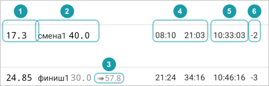

Слева направо:

-  **Дистанция** в километрах.
-  **Метки:**
  - «старт» и скорость: здесь начинается заданная скорость.
  - «смена» и скорость: здесь заданная скорость меняется.
  - После любой из них — процент и **%**, если скорость задана процентом от базовой.
  - «финиш»: здесь заданная скорость заканчивается. После метки серым показана скорость, которая заканчивается.
  - «а.время» и астрономическое время.
-  **➠ и скорость** серым, например `➠75.0`. С этой скоростью нужно ехать на оставшейся части отрезка, вне вложенных отрезков. См. [Скорость ➠](#146-скорость-).
- **Предупреждения** красным, например `🚫опоздание 10:00` (на картинке их нет). См. [Ошибки и предупреждения](#17-ошибки-и-предупреждения).
-  **Время** в минутах и секундах от старта, например `18:00` или `10:00 18:00`. Это не астрономическое время: `18:00` — это 18 минут, а `90:00` — 1 час 30 минут. Что значит каждое время, см. [Несколько значений времени в строке](#144-несколько-значений-времени-в-строке).
-  **Астрономическое время** в часах, минутах и секундах, например `10:18:00`, если у какой-то позиции секции есть «а.время».
-  **Льгота**, например `-1`, если вы включили её в настройках (см. [Льгота](#8-льгота)).

> [!TIP]
> **Продвинутый сценарий.** Маленькое число после меток «старт», «смена» и «финиш» (например, «старт1» и «финиш1») показывает, какие метки относятся друг к другу: у «старта» и «финиша», который его заканчивает, одно и то же число, как и у каждой «смены» между ними.

Если в списке позиций есть ошибка, наверху появляется красная полоса **Ошибки в позициях, расчёт невозможен**, и время не показывается совсем. См. [Ошибки и предупреждения](#17-ошибки-и-предупреждения).

**Выбор строки.** Нажмите на строку, чтобы выбрать её. Она станет бледно-жёлтой. В режиме гонки вы стартуете с выбранной строки, а панель показывает, как далеко вы от неё.

Кнопка **Редактор** открывает редактор. Для обычной работы он не нужен; см. [Редактирование позиций](#15-редактирование-позиций).

### 5.2 Меню секции

В меню (три точки):

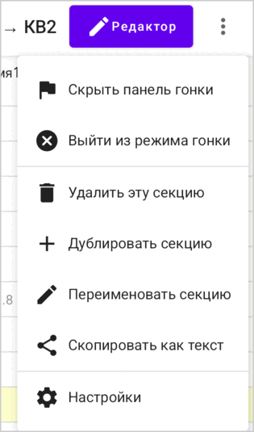

| Пункт | Что делает |
|---|---|
| **Режим гонки** / **Показать панель гонки** / **Скрыть панель гонки** / **Выйти из режима гонки** | Когда режим гонки выключен, вы видите **Режим гонки**: он включает режим гонки. Когда режим гонки включён, вместо него видно **Скрыть панель гонки** (часы продолжают идти) или **Показать панель гонки**. Когда режим гонки включён, но ни один таймер не идёт (ещё не запущен или остановлен), видно и **Выйти из режима гонки**: этот пункт выключает режим гонки и сбрасывает таймеры. |
| **Удалить эту секцию** | После первого нажатия пункт меняется на **Подтвердить удаление**. Второе нажатие удаляет секцию. Отменить это нельзя. |
| **Дублировать секцию** | Делает копию под новым именем и открывает её. |
| **Переименовать секцию** | Меняет имя. |
| **Скопировать как текст** | Копирует список позиций текстом. Его можно вставить в сообщение или в **Импорт секции** на другом устройстве. |
| **Настройки** | Открывает настройки. Откройте их отсюда после того, как проехали тарировочный участок, чтобы оттарировать адаптер (см. [Тарировка](#102-тарировка)). |

---

## 6. Режим гонки

Режим гонки — то, чем вы пользуетесь в машине. Он измеряет пройденную дистанцию, показывает опережение или отставание и по ходу движения записывает дорожную книгу в список позиций.

### 6.1 Как включить режим гонки

- На телефоне нажмите круглую кнопку **Режим гонки** внизу справа.
- На планшете нажмите **Режим гонки** в заголовке.
- На любом устройстве откройте меню (три точки) и нажмите **Режим гонки**. Это заодно закрывает редактор, если он открыт.

Приложение просит разрешения, которые нужны источнику телеметрии, например доступ к местоположению для GPS или к устройствам поблизости для OBD. Дайте их; если чего-то не хватает, диалоги приложения подскажут, что делать.

После этого под списком (или рядом с ним, если повернуть устройство) появляется панель гонки.

### 6.2 Режим гонки продолжает работать

Режим гонки работает, даже когда вы блокируете устройство, переключаетесь на другое приложение или возвращаетесь к списку секций. Его состояние видно в уведомлении, например **Ралли: ДС** с дистанцией и временем. Нажмите на уведомление, чтобы вернуться в приложение.

Когда вы снова открываете секцию, панель гонки открывается сама. Если режим гонки идёт в другой секции, панель пишет **Идёт гонка по другой секции** и показывает кнопку **Перейти к секции**.

Пока идёт таймер и открыта панель гонки, экран не гаснет. Если скрыть панель гонки, экран может погаснуть как обычно.

> [!WARNING]
> Обычно приложение продолжает работать в фоне. Некоторые телефоны (например, Xiaomi, Huawei или Samsung с его «глубоким сном приложений») могут сами закрыть его, чтобы сберечь батарею. Тогда режим гонки запускается заново, но таймеры теряются. Чтобы этого не случилось, отключите для приложения оптимизацию батареи: приложение предложит это при первом включении режима гонки (**Оптимизация батареи**), а в любой момент это можно сделать в настройках, в разделе **Работа в фоне** (см. [Работа в фоне](#106-работа-в-фоне)). Держите устройство на зарядке. До ралли проверьте: запустите таймер, заблокируйте устройство на какое-то время и убедитесь, что таймер идёт.

Чтобы скрыть панель, не останавливая таймеры, выберите в меню **Скрыть панель гонки**. Чтобы выйти из режима гонки, сначала остановите таймеры (см. ниже), а потом выберите в меню **Выйти из режима гонки**.

### 6.3 Что показывает панель гонки

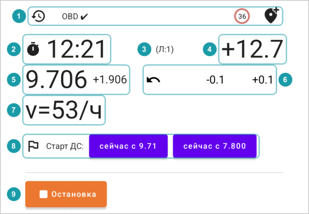

Кнопки  описаны в разделе [Поправка дистанции](#67-поправка-дистанции),  и  — в разделе [Состояния гонки](#66-состояния-гонки).

**Панель инструментов** . Ряд маленьких кнопок: **История событий** (часы со стрелкой), источник телеметрии (например, **GPS ✔**), кнопка **v** и **Добавить позицию здесь** (метка с плюсом). На телефоне, который держат вертикально, панель инструментов наверху панели гонки; на планшете или на повёрнутом телефоне — внизу, с более крупными кнопками:

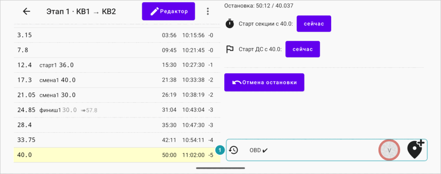

**Часы** . Пока идёт таймер ДС — время от старта ДС; иначе — время от старта секции (см. [Два таймера](#65-два-таймера-секция-и-дс)). Часы показывают минуты и секунды, а начиная с часа — и часы: `01:30:00`. (В строках то же время выглядит как `90:00`.) До времени старта часы идут в обратную сторону, с минусом.

**Опережение или отставание** . Справа от часов. Приложение считает, какое время должно быть на вашей текущей дистанции, и сравнивает его с часами:

- `+5.3` значит, что вы **отстаёте** на 5.3 секунды;
- `-12.0` значит, что вы **опережаете** на 12 секунд;
- начиная с минуты, показываются минуты и секунды: `+01:05`.

Если в списке позиций есть ошибки, это значение не показывается.

**Льгота** . Пока идёт таймер секции, если в настройках включена льгота, панель показывает `(Л:N)`: на сколько минут вы можете опережать на этой дистанции. Опережение становится красным, когда вы опережаете больше. Пока оно не красное, вы опережаете в пределах льготы. См. [Льгота](#8-льгота).

**Дистанция** . Ваша текущая дистанция в километрах, а рядом — расстояние от выбранной позиции (см. [Расстояние от выбранной позиции](#64-расстояние-от-выбранной-позиции)).

**Скорость** . `v=` — ваша скорость сейчас. Пока идёт таймер ДС, `ṽ=` — ваша средняя скорость с начала ДС.

**С каким временем в строке сравнивать часы.** Пока идёт таймер ДС, сравнивайте часы со временем отрезка ДС в строке (см. [Несколько значений времени в строке](#144-несколько-значений-времени-в-строке)): это первое время в строке. Последнее время в строке — всегда время от старта секции.

**Обратный отсчёт в списке.** Пока идёт таймер ДС, выбранная строка показывает, сколько осталось до её астрономического времени: `-15` (секунд) или `-01:30`. Когда это время прошло, отсчёт исчезает.

**Зелёная строка.** Пока идёт таймер, последняя пройденная позиция в списке подсвечена зелёным. Нажмите на неё, чтобы выбор следовал за машиной; см. [Расстояние от выбранной позиции](#64-расстояние-от-выбранной-позиции).

> [!NOTE]
> **Что значат минус и плюс.**
>
> | Где | Пример | Значение |
> |---|---|---|
> | Часы | `-00:45` | 45 секунд до старта. |
> | Опережение/отставание | `-12.0` | Опережение 12 секунд. |
> | | `+5.3` | Отставание 5.3 секунды. |
> | Дистанция до выбранной строки | `-0.300` | За 300 м до выбранной позиции. |
> | | `+0.125` | На 125 м дальше выбранной позиции. |
> | Обратный отсчёт в списке | `-15` | 15 секунд до астрономического времени выбранной строки. |
> | Льгота в списке | `-2` | В этой позиции можно опережать до 2 минут. |

### 6.4 Расстояние от выбранной позиции

Рядом с текущей дистанцией число поменьше показывает, как далеко вы ( на картинке в разделе [Что показывает панель гонки](#63-что-показывает-панель-гонки)) от **выбранной позиции**: `+0.125` — на 125 м дальше неё. Оно всегда считается от позиции, выбранной в списке, поэтому выбирайте ту строку, от которой хотите мерить.

Последняя пройденная позиция отмечена зелёным, если выбрана какая-то другая строка. Но если выбрана она сама, **выбор следует за машиной**: каждый раз, когда вы проезжаете позицию или добавляете её кнопкой **Добавить позицию здесь** или кнопкой скорости, выбор переходит на неё.

**Выбор не меняется**, если выбрана любая другая строка. Так можно считать расстояние по дорожной книге от одной из предыдущих позиций.

### 6.5 Два таймера: секция и ДС

В приложении два таймера. Панель показывает только один из них:

- **Таймер секции** (запускается из ряда **Старт секции**) ведёт время **всей секции** по её общей средней скорости (длина секции ÷ норма времени). Он нужен на дорожном участке с нормой времени. На панели — значок секундомера.
- **Таймер ДС** (запускается из ряда **Старт ДС**) ведёт время **ДС**, где учитывается каждая заданная скорость и каждая её смена. На панели — значок флажка.

| Таймер секции | Таймер ДС |
|:---:|:---:|
| 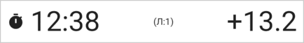 | 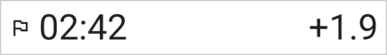 |

Оба таймера идут по **часам устройства**. Перед стартом выставьте время на устройстве вручную по официальным часам ралли.

**По какому таймеру ехать.** Опережение или отставание таймера секции сравнивает вас с равномерным движением по всей секции. На дорожном участке со льготой ориентируйтесь на таймер секции: двигайтесь так быстро, как можете, пока опережение остаётся в пределах льготы (не красное). На ДС ориентируйтесь на таймер ДС.

### 6.6 Состояния гонки

В каждом состоянии панель выглядит по-разному:

| Состояние | Что на панели | Кнопки | Куда ведёт |
|---|---|---|---|
| **Не запущена** | **Гонка не запущена** | ряд «Старт секции», ряд «Старт ДС» | таймер секции или таймер ДС |
| **Идёт таймер секции** | часы, опережение/отставание, дистанция, скорость | ряд **Старт ДС:**, **Отмена финиша** (только после ДС), **Остановка** | таймер ДС или остановка |
| **Идёт таймер ДС** | часы, опережение/отставание, дистанция, скорость и средняя скорость, кнопки скорости | **Финиш**, **Финиш-старт** | таймер секции или новый таймер ДС |
| **Остановка** | **Остановка:** со временем и дистанцией | ряд «Старт секции», ряд «Старт ДС», **Отмена остановки** | таймер секции или таймер ДС |
| **В другой секции** | **Идёт гонка по другой секции** | **Перейти к секции** | |

| Гонка не запущена | Идёт таймер секции |
|:---:|:---:|
| 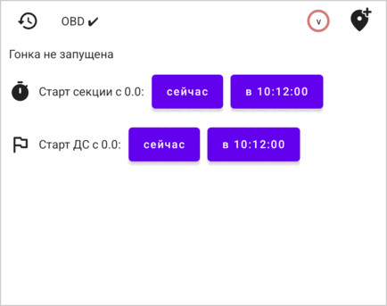 | 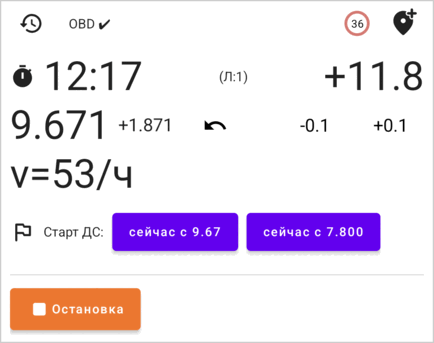 |
| **Идёт таймер ДС** | **Остановка** |
| 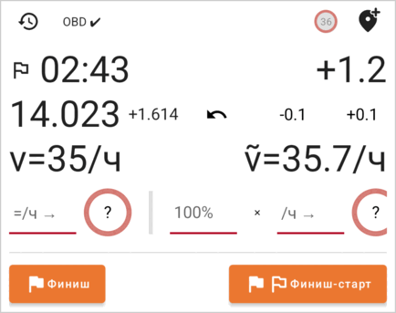 | 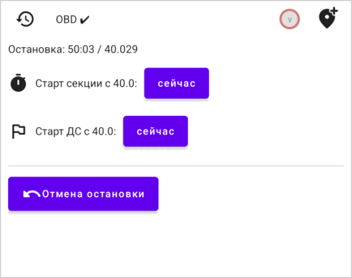 |

#### Старт: ряды «Старт секции» и «Старт ДС»

Когда ничего не идёт или после остановки, на панели два ряда. Сначала выберите в списке позицию, с которой хотите стартовать. Ряды покажут её дистанцию: **Старт секции с 0.0:** и **Старт ДС с 0.0:**.

В каждом ряду такие кнопки:

| Кнопка | Что делает |
|---|---|
| **сейчас** | Запускает часы в эту секунду с выбранной позиции. Ваша дистанция становится равной дистанции позиции. |
| **в 10:00:00** | Есть, если у выбранной позиции есть астрономическое время. Запускает часы в это время. Если оно ещё не наступило, часы до него идут в обратную сторону (с минусом). Ваша дистанция становится равной дистанции позиции. Приложение считает дистанцию с момента нажатия, в том числе во время обратного отсчёта: если машина двинулась до старта, поправьте дистанцию на линии старта. |
| **в 10:00:00, я не на старте** | Есть только после **Остановки**. То же, что **в 10:00:00**, но ваша дистанция не меняется. Нажимайте, если вы уже проехали точку старта и дистанция в приложении верная. |

Ряд **Старт секции** запускает таймер секции. Ряд **Старт ДС** запускает таймер ДС.

**Скорость ДС.** Когда вы запускаете таймер ДС, приложение назначает ДС заданную скорость. Оно берёт, по порядку:

1. запомненную скорость: скорость, которую вы выбрали кнопкой **v**, или последнюю кнопку скорости, которую вы нажали на ДС (см. [Кнопки скорости](#68-кнопки-скорости-и-кнопка-v));
2. «старт» на выбранной позиции;
3. скорость списка позиций в этой точке;
4. 60 км/ч.

Поэтому перед **каждым** ДС нажмите кнопку **v** и выберите его заданную скорость. Если кнопка **v** показывает скорость, которая для этого ДС не подходит, он начнётся с неё.

#### Пока идёт таймер секции

Ряд **Старт ДС:** (или **Следующее ДС:** после ДС) запускает таймер ДС:

| Кнопка | Что делает |
|---|---|
| **сейчас с _\<текущая дистанция\>_** | Запускает ДС сейчас, с того места, где вы находитесь. Число — ваша текущая дистанция. |
| **в 10:00:00 с _\<выбранная позиция\>_** | Есть, если у выбранной позиции есть астрономическое время. Запускает ДС в это время с выбранной позиции. Нужна для старта с места с заданным временем: добавьте в редакторе стартовую позицию с её «а.время» (см. [Редактирование позиций](#15-редактирование-позиций)), выберите её и нажмите эту кнопку. |
| **в 10:00:00 с _\<выбранная позиция\>_, я не там** | То же, но ваша текущая дистанция (одометр) не меняется. |
| **сейчас с _\<выбранная позиция\>_** | Есть, если у выбранной позиции нет астрономического времени и её дистанция отличается от дистанции в приложении. Запускает ДС сейчас с выбранной позиции и ставит вашу дистанцию на неё. Если дистанции совпадают, приложение показывает только **сейчас с _\<текущая дистанция\>_**, и она делает то же самое. |

При старте с хода нажимайте в точке старта ДС **первую** кнопку, **сейчас с _\<текущая дистанция\>_**. Остальные кнопки запускают ДС с выбранной строки: если всё ещё выбран старт секции (0.0), кнопка **в 10:00:00 с 0.000** запустила бы ДС со старта секции.

Под ними:

- **Отмена финиша** (только после финиша ДС) возвращает только что законченный ДС, как будто финиша не было.
- **Остановка** останавливает секцию и измерения. Панель показывает **Остановка:** со временем и дистанцией.

#### Пока идёт таймер ДС

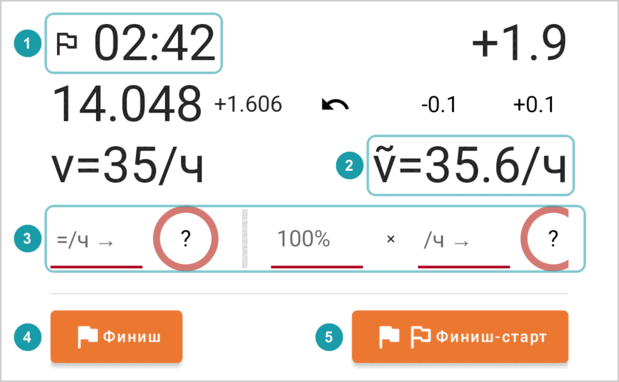

Флажок  показывает, что идёт таймер ДС, а `ṽ=`  — ваша средняя скорость на ДС. Ряд полей и кнопок скорости  описан в разделе [Кнопки скорости](#68-кнопки-скорости-и-кнопка-v).

- **Финиш**  заканчивает таймер ДС. Панель возвращается к таймеру секции и показывает **Финиш:** со временем и дистанцией ДС.
- **Финиш-старт**  заканчивает ДС и сразу запускает новый с того места, где вы находитесь. Это нужно для ДС, которые идут подряд, например на промежуточном финише, где сразу начинается следующий ДС. Отменить это нельзя.

Таймер ДС сам не заканчивается, даже после последней позиции: нажмите **Финиш**.

После **Финиша** таймер секции идёт дальше. Панель показывает законченный ДС , ряд **Следующее ДС:**  для следующего ДС и **Отмену финиша** :

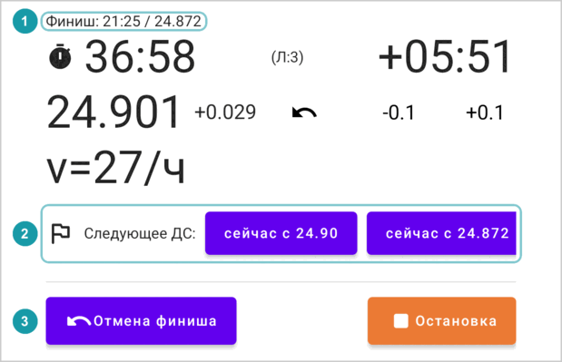

#### После остановки

- **Отмена остановки** возвращает таймер секции, как будто остановки не было.
- Ряды «Старт секции» и «Старт ДС» позволяют стартовать снова.

### 6.7 Поправка дистанции

Измеренная дистанция никогда не бывает точной. Поправляйте её на известных точках, например на позиции дорожной книги с точной дистанцией:

- **-0.1** и **+0.1** меняют дистанцию на 100 м.
- **Кнопки громкости** меняют её на 10 м (громче — прибавить, тише — убавить). Они работают, только пока открыта панель гонки и идёт таймер.
- **Нажмите на дистанцию**, чтобы ввести точное значение. Нажмите **✓**, чтобы применить его, или **✕**, чтобы отменить. Если выбрана позиция, кнопка **Я на позиции 12.345** ставит дистанцию на эту позицию.

  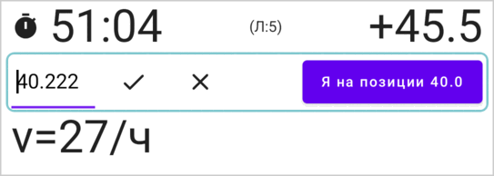

**Дистанция внутри ДС.** Приложение считает дистанцию от старта секции, и на ДС тоже. Если дорожная книга считает от старта ДС, выберите строку старта ДС (с меткой «старт»): выбор не будет меняться, и панель покажет, как далеко вы от неё (см. [Расстояние от выбранной позиции](#64-расстояние-от-выбранной-позиции)).

**Движение назад.** Если вы пропустили поворот и едете назад, нажмите кнопку **↶** (Смена направления). Она станет красной, и дистанция будет уменьшаться по ходу движения. Когда снова поедете вперёд, нажмите её ещё раз.

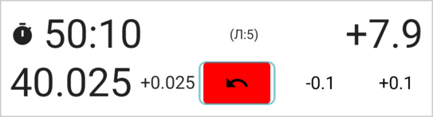

Пока вы едете назад на ДС, приложение удаляет каждую метку «смена» в тех точках, которые вы проезжаете обратно (но не раньше старта ДС). Когда снова поедете вперёд, нажимайте кнопки скорости на сменах скорости заново. Если включены звуки, приложение пищит каждые 3 секунды, пока дистанция уменьшается.

### 6.8 Кнопки скорости и кнопка «v»

Пока идёт таймер ДС, на панели есть ряд круглых кнопок скорости: **5, 10, 20, 30 … 110**. Когда меняется заданная скорость (на позиции дорожной книги или на знаке), нажмите новую скорость. Приложение:

- добавляет позицию на вашей текущей дистанции с меткой «смена» и этой скоростью, чтобы дальше время считалось по новой скорости;
- запоминает эту скорость.

На телефоне ряд не помещается на экран: прокрутите его вбок, чтобы увидеть все кнопки скорости  и поля перед ними. На планшете помещается больше:

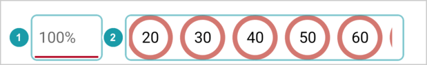

Ещё в этом ряду есть:

- **Поле «=/ч →» и его кнопка** : введите точную скорость. Процент к ней не применяется.
- **Поле процента**  (со знаком **×** после него). На некоторых ралли скорость задают процентом от ограничения скорости на знаках, например «ограничение скорости, умноженное на 80%». Введите здесь `80`. Потом нажмите ограничение со знака, например **60**: приложение возьмёт 60 × 80% = 48 км/ч.
- **Поле «/ч →» и его кнопка** : введите любую скорость и нажмите круглую кнопку рядом. Процент тоже применяется.

Если нажали не ту скорость, сразу нажмите правильную: появится ещё одна позиция с правильной скоростью. Между двумя нажатиями приложение считало по неправильной скорости, поэтому время немного неточное; чем раньше поправите, тем меньше ошибка. Потом неверную позицию можно удалить в редакторе (см. [Когда нужен редактор](#151-когда-нужен-редактор)).

**Кнопка «v»** на панели инструментов открывает тот же ряд, когда таймер ДС не идёт. Здесь скорость только **запоминается**: следующий таймер ДС стартует с ней в качестве «старта». Так задают скорость ДС до его начала. **✕**  её сбрасывает. Кнопка  показывает запомненную скорость (например, **36**), а рядом — процент, если он не 100%. Здесь скорость 36 введена в поле «=/ч →» и применена его круглой кнопкой :

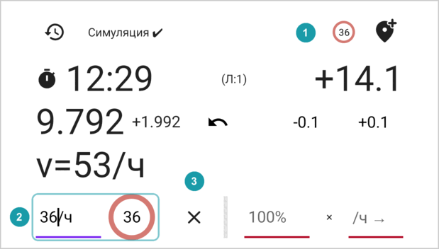

### 6.9 Добавление позиции на ходу

Кнопка **Добавить позицию здесь** (метка с плюсом, на панели инструментов) добавляет позицию на вашей текущей дистанции. Добавляйте так каждую позицию дорожной книги, которую проезжаете: у многих из них в дорожной книге нет дистанции, а приложение её покажет. Если выбор следует за машиной, он переходит на новую позицию, и панель показывает, сколько вы проехали от неё (см. [Расстояние от выбранной позиции](#64-расстояние-от-выбранной-позиции)). Кнопка работает, пока идёт таймер, и после **Остановки**.

### 6.10 История событий

Кнопка **История событий** (часы со стрелкой, на панели инструментов) открывает список того, что происходило в этой секции: когда запускались и заканчивались таймер секции и таймеры ДС, и каждую отмену. В каждой строке — дистанция и астрономическое время. Для законченных таймеров видно, сколько они шли. История сохраняется, когда приложение закрывается.

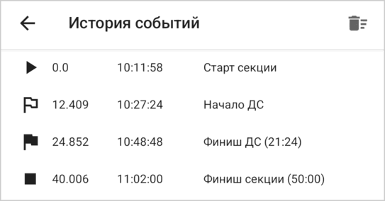

Кнопка с корзиной (**Удалить события**) сразу, без вопросов удаляет всю историю.

### 6.11 Звуки

Включите звуки в настройках (**Звуки при действиях в режиме гонки**). Тогда приложение пищит:

- когда запускается таймер;
- когда заканчивается ДС и когда вы останавливаетесь;
- когда добавляется позиция (кнопкой **Добавить позицию здесь** или кнопкой скорости);
- когда вы переключаетесь на движение назад, и потом каждые 3 секунды, пока не поедете вперёд.

---

## 7. День ралли с приложением

### 7.1 Перед ралли

- Если вы пользуетесь адаптером в машине (OBD), настройте его (см. [Источник телеметрии](#101-источник-телеметрии)) и оттарируйте, обычно накануне: организаторы публикуют тарировочный участок заранее. Проедьте его и установите тарировочный коэффициент (см. [Тарировка](#102-тарировка)). Коэффициент остаётся в настройках, пока вы его не поменяете.
- Освойте приложение с источником **Симуляция** (см. [Измерение дистанции](#9-измерение-дистанции)) или с автосимулятором (**OutGauge**).
- Если у пилота второе устройство, настройте его (см. [Экран пилота](#11-экран-пилота)).

### 7.2 Когда вы получили дорожную книгу

На ралли третьей категории дорожную книгу выдают незадолго до старта. Приложению от неё нужно совсем немного:

1. Создайте секцию для каждой части дорожной книги, которая начинается в заданное астрономическое время, например от одного КВ до следующего (см. [Создание секции](#41-создание-секции)). Введите её длину, норму времени или среднюю скорость и время старта.
2. Если вы знаете, где начинается ДС, можно добавить в секцию его стартовую позицию (см. [Редактирование позиций](#15-редактирование-позиций)).

Всё остальное (где каждый ДС начинается и заканчивается и где меняется его скорость) вы записываете в режиме гонки по ходу движения.

### 7.3 Перед стартом

- Выставьте время на устройстве вручную по официальным часам.
- Разрешите приложению работать без ограничений батареи и подключите устройство к питанию.
- Включите режим гонки и проверьте источник телеметрии на панели инструментов (например, **GPS ✔**). См. [Измерение дистанции](#9-измерение-дистанции).
- Если у пилота второе устройство, проверьте, что на нём **Данные✔**.

### 7.4 На старте

Выберите стартовую позицию (0.0). Нажмите **в 10:00:00** в ряду **Старт секции**. Часы отсчитывают время до старта . Опережение  до старта красное: в этот момент вы опережаете.

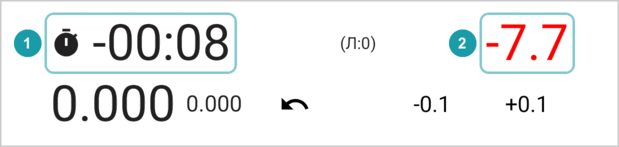

Если судья даёт вам другую минуту, нажмите **Остановка** (это работает и во время обратного отсчёта), а потом нажмите **сейчас** в ряду «Старт секции» в момент старта.

### 7.5 ДС внутри дорожного участка

1. До начала ДС нажмите кнопку **v** и выберите его заданную скорость.
2. В точке старта ДС нажмите первую кнопку ряда **Старт ДС:**, **сейчас с …** с вашей текущей дистанцией. Если у ДС своё время старта, нажмите её точно в эту секунду. Потом, если нужно, поправьте дистанцию на точку старта.
3. На каждой смене заданной скорости нажимайте новую скорость.
4. В конце ДС нажмите **Финиш**. Таймер секции идёт дальше, до конца дорожного участка. С этого места ориентируйтесь на таймер секции: двигайтесь так быстро, как можете, пока опережение не красное.
5. В конце дорожного участка нажмите **Остановка**.

### 7.6 Переход к следующей секции

Режим гонки ведёт время одной секции за раз. В конце секции:

1. Нажмите **Финиш** (если идёт таймер ДС), потом **Остановка**.
2. Вернитесь к списку секций и откройте следующую секцию.
3. Выберите стартовую позицию и стартуйте, как описано в разделе [На старте](#74-на-старте).

Делайте это, пока ждёте на КВ, до вашего следующего времени старта.

### 7.7 На трассе

- **Известные точки.** Когда проезжаете позицию с точной дистанцией из дорожной книги, поправьте дистанцию (см. [Поправка дистанции](#67-поправка-дистанции)).
- **Внезапный контроль времени.** Он может оказаться в любом месте дороги. На дорожном участке со льготой не двигайтесь быстрее, чем позволяет льгота: пока опережение таймера секции не красное, внезапный контроль времени вам не страшен.
- **Ошибки.** Если свернули не туда, нажмите **↶** (см. [Поправка дистанции](#67-поправка-дистанции)). Если нажали не ту кнопку скорости, см. [Кнопки скорости](#68-кнопки-скорости-и-кнопка-v). Если нажали **Финиш** слишком рано, нажмите **Отмена финиша**. Если нажали **Остановка** слишком рано, нажмите **Отмена остановки**.

### 7.8 После этапа

- Откройте **Историю событий**, чтобы посмотреть, когда каждый таймер запускался и заканчивался и сколько он шёл.
- В секции теперь записаны пройденные ДС. Её можно оставить, чтобы посмотреть потом, или удалить.

---

## 8. Льгота

На некоторых ралли на внезапном контроле времени на дорожном участке разрешено опережение на несколько минут, и это число растёт со временем от старта секции: это льгота. В её пределах опережение не штрафуется. Включите её в настройках, в разделе **Льгота**:

| Вариант | Правило | Примеры |
|---|---|---|
| **Без льготы** | Льготы нет. | |
| **⌊t/10⌋** | Время в минутах, делённое на 10, **с округлением вниз**: одна минута за каждые полные 10 минут. | 9 мин → 0; 10 мин → 1; 11 мин → 1 |
| **⌈t/10⌉** | Время в минутах, делённое на 10, **с округлением вверх**: одна минута за каждые 10 минут или их часть. | 9 мин → 1; 10 мин → 1; 11 мин → 2 |

Приложение берёт время от старта секции (последнее время в строке). Льгота показывается как `-N` в конце строки: `-2` значит, что в этой позиции можно опережать до 2 минут. Пока идёт таймер ДС, она не показывается.

Пока идёт таймер секции, панель гонки показывает льготу как `(Л:N)` рядом с опережением. Опережение становится красным, когда вы опережаете **больше** чем на N минут, то есть сильнее, чем позволяет льгота. См. [Что показывает панель гонки](#63-что-показывает-панель-гонки).

---

## 9. Измерение дистанции

Источник выбирается в настройках, в разделе **Источник телеметрии**. Его можно менять на ходу.

| Источник | Как работает |
|---|---|
| **GPS** | Использует местоположение устройства. Больше ничего не нужно. Лучше всего работает при открытом небе. Тарировка не влияет на дистанцию по GPS. |
| **OBD через Bluetooth** | Читает скорость машины через адаптер ELM327 (OBD), который вставляется в диагностический разъём машины, обычно под приборной панелью. Приложение считает дистанцию по скорости. Сначала соедините адаптер с устройством: вставьте его, включите зажигание и выберите адаптер в настройках Bluetooth устройства. |
| **OutGauge** | Получает скорость из автосимулятора на компьютере (например, BeamNG) по Wi-Fi. Для тренировки дома. Тарировка на неё не влияет. |
| **Симуляция** | Ползунок **Скорость:** на панели гонки задаёт скорость от 0 до 100 км/ч. Это лучший способ разобраться в приложении и привыкнуть к нему до ралли. |

Состояние источника видно на панели инструментов панели гонки. Нажмите на него, чтобы открыть настройки. Оранжевый текст означает проблему.

| Текст | Значение |
|---|---|
| **GPS ✔ (9 спут.)** | Хороший сигнал GPS от 9 спутников. |
| **GPS ± (5 спут.)** | Слабый сигнал GPS. Приложение считает дистанцию по скорости, а не по координатам. |
| **GPS: нет позиции (3 спут.)** | Нет пригодного сигнала GPS. Скорость показывается как 0. |
| **GPS: ожидание… (0 спут.)** | Ждём первого сигнала GPS. Если это надолго, проверьте, что приложению разрешён доступ к местоположению. |
| **GPS: геолокация выкл.!** | На устройстве выключена геолокация. Включите её. |
| **GPS: недоступен!** | На устройстве нет GPS-приёмника. Выберите другой источник. |
| **OBD: подключение…** | Подключение к адаптеру в машине. |
| **OBD ✔** | Адаптер работает. |
| **OBD: нет разрешений!** | Приложению не разрешён Bluetooth. Разрешите его в настройках устройства. |
| **OBD: нет MAC-адреса в настройках!** | В настройках не выбран адаптер. |
| **OutGauge: ожидание…** | Ждём данных из автосимулятора. |
| **OutGauge ✔** | Данные из автосимулятора приходят. |
| **OutGauge: задержка** | Данных нет 2 секунды. Скорость показывается как 0. |
| **OutGauge: ошибка** | Приложение не может получать данные, например потому что тот же порт занят другим приложением. |
| **Симуляция ✔** | Включён ползунок симуляции. |
| **Телеметрия не запущена** | Ни один источник ещё не работает. |

Как приложение обращается с GPS: очень плохой сигнал оно не учитывает. При слабом сигнале оно берёт скорость. Когда машина стоит, координаты GPS всё равно немного «гуляют»; чтобы это не добавляло дистанцию, приложение перестаёт её прибавлять, если машина не двигалась 3 секунды.

---

## 10. Настройки

Приложение сохраняет каждую настройку сразу, кроме тарировочного коэффициента: у него своя кнопка **Сохранить**.

### 10.1 Источник телеметрии

См. [Измерение дистанции](#9-измерение-дистанции).

- Для **OBD через Bluetooth** сначала соедините адаптер ELM327 с устройством (см. [Измерение дистанции](#9-измерение-дистанции)). Потом нажмите кнопку  справа от поля **MAC-адрес Bluetooth-устройства**  и выберите адаптер из списка. Тарировочный коэффициент  описан ниже.

  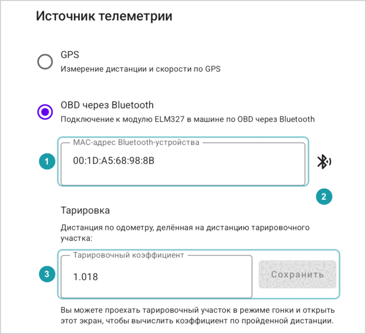
- Для **OutGauge** введите **UDP-порт** (число от 1024 до 65535; по умолчанию 4444). В автосимуляторе укажите тот же порт и адрес этого устройства, который приложение показывает под полем.

### 10.2 Тарировка

Машина измеряет дистанцию немного не так, как в дорожной книге. Разницу описывает **тарировочный коэффициент**:

> тарировочный коэффициент = дистанция по машине ÷ дистанция по дорожной книге

Например, если в дорожной книге 10.00 км, а машина намерила 10.20 км, коэффициент — 1.02. Приложение делит скорость от адаптера на этот коэффициент. Он действует только для **OBD через Bluetooth**: на дистанцию по GPS и на скорость из автосимулятора он не влияет. Поля тарировки появляются в настройках, только когда выбран источник **OBD через Bluetooth**.

**Как оттарировать на тарировочном участке** (с источником **OBD через Bluetooth**):

1. Создайте секцию для тарировочного участка, начиная с 0.0.
2. На старте участка включите режим гонки, выберите позицию 0.0 и нажмите **сейчас** в ряду «Старт секции».
3. Проедьте участок и остановите машину в его конце. Можно нажать **Остановка**, но не нажимайте **Выйти из режима гонки**, пока не оттарируете.
4. Откройте **Настройки** из меню секции (три точки) или нажмите на текст источника телеметрии на панели инструментов панели гонки. Не открывайте их из списка секций. Теперь в настройках есть **Дистанция по одометру:**. Здесь «одометр» — это дистанция, которую приложение намерило по адаптеру, а не показания приборной панели.
5. Введите точную длину участка в поле **Длина тарировочного участка**. Приложение заполнит тарировочный коэффициент. Прежний коэффициент неважен: приложение его учитывает.
6. Нажмите **Сохранить**.

### 10.3 Отправка данных на устройство пилота

Введите адрес устройства пилота в поле **IP-адрес устройства пилота**. См. [Экран пилота](#11-экран-пилота).

### 10.4 Льгота

См. [Льгота](#8-льгота).

### 10.5 Режим гонки

**Звуки при действиях в режиме гонки** включает и выключает звуковые сигналы. См. [Звуки](#611-звуки).

### 10.6 Работа в фоне

Показывает, может ли устройство остановить приложение ради экономии батареи: **Оптимизация батареи: включена** или **отключена для приложения**. **Настройки батареи** открывает место, где её можно отключить. **Советы для устройства** открывает советы для производителя вашего устройства: у некоторых производителей есть свои способы экономить батарею поверх Android. См. предупреждение в разделе [Режим гонки продолжает работать](#62-режим-гонки-продолжает-работать).

---

## 11. Экран пилота

Второе устройство может показывать пилоту тот же список и ту же панель гонки, что видите вы, но без кнопок. Оба устройства должны быть в одной сети Wi-Fi. В машине её можно создать: включите точку доступа на своём телефоне (в настройках телефона, в разделе сети или подключений; телефон раздаёт интернет по Wi-Fi) и подключите к ней устройство пилота.

**На устройстве пилота:**

1. В списке секций откройте меню и выберите **Экран пилота**. Секции на устройстве пилота не нужны.
2. На экране — сетевой адрес этого устройства: числа вроде **• 192.168.1.23 (Wi-Fi)**. Нажмите на него, чтобы скопировать.

**На вашем устройстве:**

1. Откройте **Настройки** и введите этот адрес в поле **IP-адрес устройства пилота**. Адрес может меняться день ото дня, поэтому проверяйте его перед каждым ралли.
2. Включите режим гонки в секции.

Теперь на устройстве пилота видно:

- секцию и её позиции, с вашей выбранной строкой и зелёной строкой;
- панель гонки: часы, опережение или отставание, дистанцию, дистанцию до выбранной строки, скорость;
- обратный отсчёт в выбранной строке.

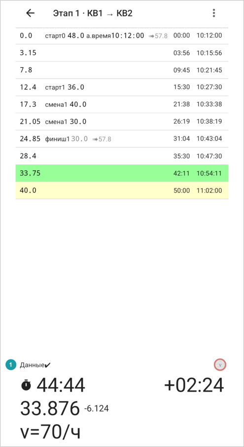

Устройство пилота не показывает льготу, и на нём нет кнопок, чтобы управлять гонкой. Кнопка **↶** видна на нём, только пока вы едете назад. Состояние связи  видно над панелью:

| Текст | Значение |
|---|---|
| **Данные: ожидание** | Данных ещё нет. Проверьте адрес, Wi-Fi и что на вашем устройстве включён режим гонки. |
| **Данные✔** | Данные приходят. |
| **Данные ???** | Новых данных нет больше секунды. |
| **Данные: несовместимая версия** | На устройствах разные версии приложения. Установите одну и ту же версию на оба, лучше [последнюю](https://github.com/h0tk3y/rally/releases/latest). |

Пункт **Поменять местами** в меню (три точки) экрана пилота ставит панель гонки над списком, чтобы часы были наверху; на повёрнутом устройстве панель встаёт слева. Приложение запоминает выбор.

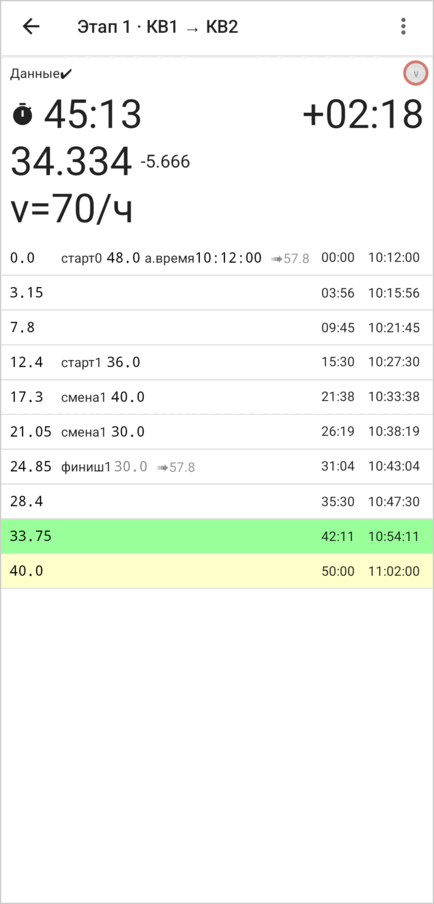

Чтобы выключить экран пилота, выйдите с него.

---

## 12. Сохранение, копирование и обмен

- Приложение сохраняет каждое изменение сразу.
- **Скопировать как текст** копирует список позиций, чтобы его можно было отправить в сообщении. На другом устройстве создайте из него секцию через **Импорт секции** (см. [Импорт секции](#18-импорт-секции)).
- **Дублировать секцию** делает копию. Дайте ей новое имя: у двух секций не может быть одинакового имени.

---

## 13. Вопросы и проблемы

**Время пропало, а на экране красная полоса.**
В списке позиций ошибка, обычно после правки в редакторе. Найдите красные сообщения в строках и см. [Ошибки и предупреждения](#17-ошибки-и-предупреждения).

**Время в строках изменилось, когда я открыл панель гонки.**
Когда панель гонки открыта, а таймер ДС не идёт, список показывает время секции. См. [Время секции в режиме гонки](#148-время-секции-в-режиме-гонки).

**Не получается ввести двоеточие при создании секции.**
Вместо него ставьте `-` или `.`: `1-30` или `1.30` для 1 часа 30 минут. См. [Создание секции](#41-создание-секции).

**Пропало время старта, которое я ввёл.**
Старт таймера кнопкой **сейчас** заменяет его на момент нажатия. Кнопки **в…** его сохраняют. ДС, запущенный кнопкой **сейчас**, переносит астрономическое время на стартовую позицию ДС; **Финиш** возвращает старту секции его время старта. См. [Как режим гонки заполняет список позиций](#16-как-режим-гонки-заполняет-список-позиций).

**ДС начался не с той скоростью.**
ДС взял запомненную скорость кнопки **v**. Сразу нажмите правильную скорость в ряду кнопок скорости или поправьте скорость в списке позиций в редакторе — сразу или позже, когда будет время. Перед следующим ДС задайте его скорость кнопкой **v**. См. [Скорость ДС](#66-состояния-гонки).

**Не показывается опережение или отставание.**
В списке позиций ошибки. Сначала исправьте список позиций.

**Дистанция не растёт.**
Проверьте источник телеметрии на панели гонки (см. [Измерение дистанции](#9-измерение-дистанции)). Для GPS дождитесь **GPS ✔**. Для OBD проверьте адаптер в настройках и что на него подаётся питание.

**Кнопки громкости меняют громкость, а не дистанцию.**
Они меняют дистанцию, только пока открыта панель гонки и идёт таймер. После ввода в поле панели гонки они могут снова начать менять громкость.

**Устройство пилота пишет «Данные: ожидание».**
Проверьте, что оба устройства в одной сети Wi-Fi, что адрес на вашем устройстве верный и что на вашем устройстве включён режим гонки. Если написано **Данные: несовместимая версия**, установите одну и ту же версию приложения на оба устройства, лучше [последнюю](https://github.com/h0tk3y/rally/releases/latest).

**Я стартовал не с той позиции.**
Отменить старт нельзя. Если запустился таймер секции, нажмите **Остановка**, выберите нужную позицию и стартуйте снова. На ДС нажмите **Финиш** и запустите новый ДС с нужной позиции. После этого проверьте позиции: режим гонки добавил метки для неверного старта (см. [Как режим гонки заполняет список позиций](#16-как-режим-гонки-заполняет-список-позиций)). Если они попадают на участок, который вы потом проехали по-настоящему, удалите их в редакторе, иначе они испортят список позиций.

---

## Продвинутые сценарии

Дальше руководство объясняет, как приложение считает время, как менять список позиций вручную, как режим гонки записывает дорожную книгу и что значат сообщения об ошибках. Это нужно, только чтобы исправлять ошибки и понимать, как всё устроено.

## 14. Как приложение считает время

Эта глава объясняет, как приложение превращает список позиций во время. Она помогает читать строки и проверять, что приложение правильно записало дорожную книгу.

В примерах ниже метки записаны так, как в тексте для импорта: `setavg` («старт»), `thenavg` («смена»), `endavg` («финиш») и `atime` («а.время»).

### 14.1 Метки

- **Дистанция.** Расстояние от старта секции в километрах, до трёх знаков после точки: `12.345`. Приложение держит позиции по порядку дистанции. У двух позиций может быть одна и та же дистанция.
- **«старт» 60**: отсюда заданная средняя скорость — 60 км/ч. Если ещё открыт другой отрезок, начинается вложенный отрезок.
- **«смена» 40**: отсюда заданная средняя скорость — 40 км/ч. Часы отрезка продолжают идти; меняется только скорость.
- **«финиш»**: здесь заканчивается отрезок, который начался последним и ещё открыт. Последнему отрезку секции «финиш» не нужен: он идёт до последней позиции.
- **Процент.** На некоторых ралли скорость задают процентом от базовой, обычно меньше 100%, например «ограничение скорости на знаках, умноженное на 80%». Приложение показывает такую скорость как базовую скорость и процент: `60.0 80 %`. Настоящая скорость — 60 × 80% = 48 км/ч.
- **«а.время» 10:00:00**: в этой позиции часы ралли показывают 10:00:00. У секции может быть только одно астрономическое время.

### 14.2 Одна средняя скорость

Простейший список позиций — с одним «стартом»:

```
0.0   setavg 60
30.0
90.0
```

При 60 км/ч километр проходится за минуту. Поэтому время такое:

| Позиция | Время |
|---|---|
| 0.0 | 00:00 |
| 30.0 | 30:00 |
| 90.0 | 90:00 |

Время — минуты и секунды от старта. Минут может быть больше 59: `90:00` — это 1 час 30 минут.

**Смена скорости меткой «смена».** Когда скорость меняется, часы продолжают идти:

```
0.0   setavg 60
10.0  thenavg 30
20.0  endavg
```

| Позиция | Время | Почему |
|---|---|---|
| 0.0 | 00:00 | |
| 10.0 | 10:00 | 10 км при 60 км/ч |
| 20.0 | 30:00 | потом 10 км при 30 км/ч — ещё 20 минут |

### 14.3 Вложенные отрезки

Вложенный отрезок — это отрезок со своей скоростью внутри более длинного отрезка, общее время которого не меняется. Типичный случай — ДС внутри дорожного участка. Режим гонки записывает его сам (см. [Как режим гонки заполняет список позиций](#16-как-режим-гонки-заполняет-список-позиций)): «старт» в начале ДС, «финиш» в его конце.

```
0.0   setavg 60
10.0  setavg 30
15.0  endavg
30.0
```

Это значит:

- **Дорожный участок** — от 0.0 до 30.0 при 60 км/ч. Все 30 км нужно пройти за **30 минут**.
- **ДС** (вложенный отрезок) — от 10.0 до 15.0 при 30 км/ч. Эти 5 км нужно пройти за **10 минут**.
- На остальные **25 км** остаётся **20 минут**. Значит, эти 25 км нужно ехать со скоростью 25 ÷ 20 × 60 = **75 км/ч**.

Приложение показывает:

| Позиция | Время | ➠ |
|---|---|---|
| 0.0 «старт» 60 | 00:00 | ➠75.0 |
| 10.0 «старт» 30 | 08:00 | |
| 15.0 «финиш» | 10:00 18:00 | ➠75.0 |
| 30.0 | 30:00 | |

Как это читать:

- На 0.0 приложение говорит ехать 75 км/ч (➠75.0) до начала ДС.
- Вы приезжаете на 10.0 в 08:00 (10 км при 75 км/ч).
- ДС занимает 10:00, поэтому на 15.0 вы в 18:00 от старта.
- На 15.0 приложение снова говорит ехать 75 км/ч до конца.
- На 30.0 вы в 30:00 — это время всего дорожного участка при 60 км/ч.

Сравните с меткой «смена»: с «сменой» 30 на 10.0 и «сменой» 60 на 15.0 каждая часть просто занимает время по своей скорости, и в сумме выходит 10 + 10 + 15 = 35 минут.

**Схема «старт» – «смена» – «финиш».** Когда заданная скорость меняется внутри ДС, режим гонки добавляет «смену». Часы ДС продолжают идти:

```
0.0   setavg 60
10.0  setavg 30
15.0  thenavg 90
24.0  endavg
30.0
```

- ДС — от 10.0 до 24.0: 5 км при 30 км/ч (10 минут), потом 9 км при 90 км/ч (6 минут). Всего 16 минут.
- Дорожный участок по-прежнему занимает 30 минут. На остальные 16 км (от 0.0 до 10.0 и от 24.0 до 30.0) остаётся 14 минут, поэтому скорость ➠ — 16 ÷ 14 × 60 = 68.6 км/ч.

Строки показывают:

| Позиция | Время | ➠ |
|---|---|---|
| 0.0 «старт» 60 | 00:00 | ➠68.6 |
| 10.0 «старт» 30 | 08:45 | |
| 15.0 «смена» 90 | 10:00 18:45 | |
| 24.0 «финиш» | 16:00 24:45 | ➠68.6 |
| 30.0 | 30:00 | |

Вложенный отрезок может лежать внутри другого вложенного отрезка. Приложение считает каждый уровень одинаково.

### 14.4 Несколько значений времени в строке

Позиция внутри вложенного отрезка показывает по одному времени на каждый отрезок, в котором она лежит, слева направо:

1. время от начала самого маленького отрезка вокруг неё;
2. время от начала следующего, более длинного отрезка;
3. … и так далее;
4. последним — время от старта секции.

Так, в `10:00 18:00` `10:00` — время от старта ДС, а `18:00` — время от старта секции.

Если у какой-то позиции секции есть астрономическое время, дальше в строке показано астрономическое время в этой позиции, например `10:18:00` (см. [Астрономическое время](#147-астрономическое-время)).

Позиция, где начинается вложенный отрезок (с «стартом»), показывает только время более длинных отрезков вокруг, без своего 00:00. (Отрезки, которые идут друг за другом, как в следующем разделе, — другое дело: каждый из них начинается с 00:00.)

### 14.5 Отрезки друг за другом

Можно также закончить отрезок и начать новый на той же дистанции, каждый со своим временем: две позиции с одинаковой дистанцией, сначала «финиш»:

```
0.0   setavg 60
5.0
10.0  endavg
10.0  setavg 30
15.0
20.0  endavg
```

Приложение считает всю секцию одним отрезком, в котором лежат два отрезка. Строки показывают:

| Позиция | Время |
|---|---|
| 0.0 «старт» 60 | 00:00 |
| 5.0 | 05:00 |
| 10.0 «финиш» | 10:00 |
| 10.0 «старт» 30 | 00:00 10:00 |
| 15.0 | 10:00 20:00 |
| 20.0 «финиш» | 20:00 30:00 |

Во втором отрезке в каждой строке два времени: время внутри этого отрезка и время от старта секции. Его строка со «стартом» показывает 00:00, потому что там начинается новый отрезок. В первом отрезке оба времени совпадают, поэтому приложение показывает одно.

Новый «старт» должен быть точно на той же дистанции, что и «финиш» перед ним. Если есть разрыв, приложение показывает ошибку `не вся дистанция покрыта скоростью` (см. [Ошибки и предупреждения](#17-ошибки-и-предупреждения)).

### 14.6 Скорость ➠

Серое значение **➠** — скорость, с которой нужно ехать на тех частях отрезка, что лежат вне его вложенных отрезков (см. пример в разделе [Вложенные отрезки](#143-вложенные-отрезки)). Приложение показывает её:

- в начале отрезка, в котором есть вложенные отрезки, и
- в конце каждого вложенного отрезка: «отсюда ехать с этой скоростью».

В последней позиции секции и на «смене» внутри вложенного отрезка она не показывается: там вы остаётесь внутри вложенного отрезка, и остаток дороги ещё не начался.

**Как ею пользоваться.** В теории вы держите скорость ➠ всю дорогу. На настоящей дороге длинный отрезок с одной ровной скоростью не проехать, поэтому считайте скорость ➠ подсказкой о темпе отрезка. На практике двигайтесь так быстро, как можете в пределах льготы (см. [Льгота](#8-льгота)), а по опережению таймера секции проверяйте, что не слишком опережаете.

Если вложенным отрезкам нужно больше времени, чем есть на весь более длинный отрезок, полезную скорость ➠ приложение дать не может. Вместо неё оно показывает предупреждение `🚫опоздание` (см. [Ошибки и предупреждения](#17-ошибки-и-предупреждения)).

### 14.7 Астрономическое время

Когда у одной позиции есть астрономическое время, приложение считает астрономическое время каждой позиции **после** неё: это время плюс время на дорогу до неё.

Например, со «стартом» 60 на 0.0 и «а.время» 10:00:00 на 10.0 позиция на 20.0 показывает `10:10:00`.

Когда открыта панель гонки, а таймер ДС не идёт, приложение показывает астрономическое время и у позиций **до** позиции с астрономическим временем, по общей средней скорости (см. [Время секции в режиме гонки](#148-время-секции-в-режиме-гонки)).

После полуночи астрономическое время снова начинается с 00:00:00. День приложение не показывает.

### 14.8 Время секции в режиме гонки

Когда открыта панель гонки, а таймер ДС не идёт, список показывает **время секции** вместо обычного. Его приложение считает так, будто вы проехали всю секцию с её общей средней скоростью, без вложенных отрезков:

> общая средняя скорость = длина секции ÷ норма времени секции

По этому времени работает таймер секции. Когда запускается таймер ДС, список возвращается к обычному времени.

| Панель гонки скрыта: обычное время | Панель гонки открыта: время секции |
|:---:|:---:|
| 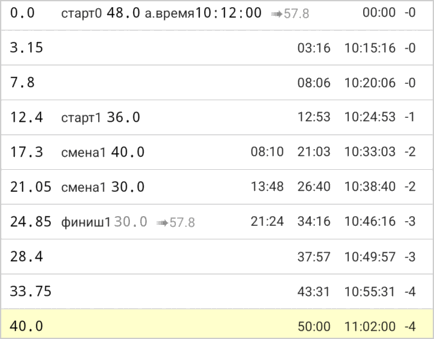 | 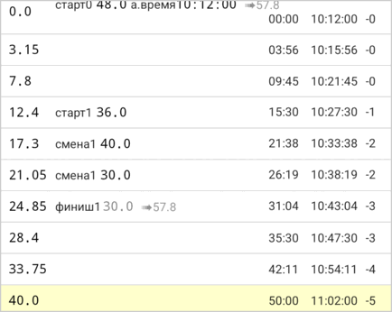 |

> [!NOTE]
> Какое время вы видите, подсказывает значок рядом с часами. С флажком (идёт таймер ДС) строки показывают обычное время. С секундомером (идёт только таймер секции), а также до старта и после **Остановки**, — время секции.

---

## 15. Редактирование позиций

Редактор позволяет менять список позиций вручную. Будьте осторожны: неверный «старт», «смена» или «финиш» может сломать расчёт для всей секции, и тогда пропадёт опережение и отставание.

### 15.1 Когда нужен редактор

Редактор нужен в таких случаях:

- **Исправить ошибку во время ралли.** Например, удалить неверную смену скорости или поправить дистанцию.
- **Подготовить известный старт.** Например, добавить стартовую позицию ДС с её астрономическим временем для старта с места.
- **Быстро посчитать.** Например, узнать, какая скорость или норма времени нужна на отрезке, вне режима гонки.

Во всех остальных случаях создайте секцию (см. [Создание секции](#41-создание-секции)) и проедьте её в режиме гонки: режим гонки сам расставит метки.

**После каждой правки проверяйте список.** Нажмите **Расчёт**: если появилась красная полоса **Ошибки в позициях, расчёт невозможен**, см. [Ошибки и предупреждения](#17-ошибки-и-предупреждения) и исправьте ошибку, прежде чем ехать дальше.

### 15.2 Как работает редактор

Нажмите **Редактор**. Внизу экрана появится клавиатура приложения , а кнопка сменится на **Расчёт** . Обычная клавиатура устройства не появляется. Приложение сохраняет каждое изменение сразу; кнопки «Сохранить» нет. Пока открыт редактор, время не показывается.

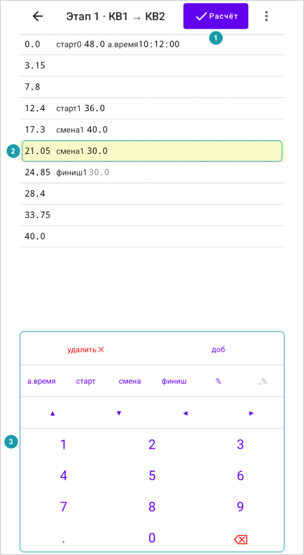

Нажмите на строку, чтобы выбрать её . Нажмите на значение в строке (дистанцию, скорость, процент или астрономическое время), чтобы начать его вводить. Мигающая черта, **курсор**, показывает, куда попадёт следующая цифра.

Редактор можно открыть, пока в режиме гонки идёт таймер. Тогда клавиатура встаёт на место панели гонки, а таймер продолжает идти. Нажмите **Расчёт**, а потом **Показать панель гонки** в меню, чтобы снова увидеть панель.

### 15.3 Клавиши

| Клавиша | Что делает |
|---|---|
| **удалить ╳** | Удаляет выбранную позицию. Выбранной становится следующая. |
| **доб** | Добавляет новую позицию под выбранной, на той же дистанции. Её дистанция выделена, поэтому введённые цифры заменяют её; строка встанет на своё место. |
| **а.время** | Даёт позиции астрономическое время (00:00:00), которое можно сразу вводить. Нажмите ещё раз, пока вводите время, чтобы убрать его. У секции может быть только одно астрономическое время, поэтому оно убирается у других позиций. |
| **старт** | Делает позицию «стартом», скорость можно сразу вводить. Нажмите ещё раз, пока вводите скорость или процент, чтобы убрать метку. |
| **смена** | То же, что **старт**, но для «смены». |
| **финиш** | Делает позицию «финишем» или убирает «финиш», если он есть. |
| **%** | Добавляет к скорости процент (100%), который можно сразу вводить. Нажмите ещё раз, пока вводите процент, чтобы убрать его. Работает только на позиции со «стартом» или «сменой». |
| **_%** | Показывает последний введённый процент, например **80%**. Нажмите, чтобы дать выбранной позиции этот процент. |
| **▲ ▼** | Выбирают позицию выше или ниже. |
| **◀ ▶** | Двигают курсор влево или вправо. В начале или в конце значения переходят к предыдущему или следующему значению в строке. |
| **0–9** | Вводят цифру в месте курсора. |
| **.** | Ставит десятичную точку в месте курсора. Работает в дистанции, скорости и проценте, но не в астрономическом времени. |
| **⌫** | Удаляет цифру слева от курсора. |

У позиции может быть только одна из меток «старт», «смена» и «финиш». Если нажать **старт** на позиции со «сменой», она станет «стартом» с той же скоростью.

Клавиша, которую сейчас нельзя использовать, бледная и ничего не делает. Например, **▲** бледная на первой позиции.

### 15.4 Ввод астрономического времени

В астрономическом времени каждая цифра заменяет цифру под курсором, а курсор перескакивает через двоеточия. Приложение даёт ввести только существующее время: часы от 00 до 23, минуты и секунды от 00 до 59. Цифры, которые дали бы неверное время, бледные. **⌫** сбрасывает цифру слева в 0.

### 15.5 Когда строка перемещается

Список всегда идёт по порядку дистанции. Когда вы меняете дистанцию, строка прямо во время ввода переезжает на новое место и остаётся выбранной. Например, если поменять 3.0 на 39.0, введя 9, строка перескочит ниже 5.0. Если потом нажать **⌫**, она вернётся обратно.

---

## 16. Как режим гонки заполняет список позиций

**Перед ДС**, пока вы ещё едете по дорожному участку, задайте стартовую скорость ДС кнопкой **v** (см. [Кнопки скорости](#68-кнопки-скорости-и-кнопка-v)). Таймер ДС стартует с этой скоростью.

В созданной секции есть только старт и финиш. По ходу движения режим гонки дописывает остальное:

| Вы нажимаете | Приложение записывает |
|---|---|
| **сейчас** в ряду «Старт секции» или «Старт ДС» | Время старта как астрономическое время («а.время») стартовой позиции. |
| **в 10:00:00** | Берёт астрономическое время, которое уже есть у выбранной позиции, и оставляет его. (Кнопки **в…** есть, только когда у выбранной позиции есть астрономическое время.) |
| Старт **ДС** | Метку «старт» со скоростью ДС на стартовой позиции. Иногда для этого приложение добавляет новую позицию в точке старта. (Старт кнопкой **сейчас** ещё и записывает время старта, как выше.) |
| Кнопку скорости на ДС | Новую позицию на вашей дистанции с меткой «смена» и этой скоростью. |
| **Финиш** | Новую позицию на вашей дистанции с меткой «финиш», которая заканчивает отрезок ДС, если список позиций ещё не заканчивает его. Потом приложение возвращает старту секции его время старта. |
| **Отмена финиша** | Удаляет позицию, которую добавил **Финиш**. |
| **Добавить позицию здесь** | Новую позицию на вашей дистанции без меток. |

> [!NOTE]
> Пока ДС идёт, у него ещё нет конца, поэтому приложение считает, что он продолжается до конца секции. Пока вы не нажали **Финиш**, время, скорости ➠ и даже предупреждение `🚫опоздание` после старта ДС могут выглядеть неправильно. После финиша всё снова верно.

Так после ДС внутри дорожного участка в списке позиций есть вложенный отрезок: «старт» в начале ДС, «смена» на каждой смене скорости, «финиш» в его конце. По нему приложение считает время для оставшейся части дорожного участка (см. [Вложенные отрезки](#143-вложенные-отрезки)).

> [!NOTE]
> **Движение назад** на ДС удаляет **каждую** метку «смена» в точках, которые вы проезжаете обратно, в том числе и те, что вы добавили не на этом ДС (см. [Поправка дистанции](#67-поправка-дистанции)).

---

## 17. Ошибки и предупреждения

Когда в списке позиций ошибка, приложение не может посчитать время. Наверху оно показывает **Ошибки в позициях, расчёт невозможен** , а в каждой строке с ошибкой — красное сообщение .

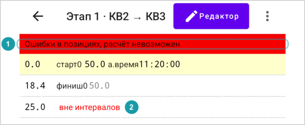

Режим гонки таких ошибок не делает; они появляются после правок в редакторе или из импортированного текста.

| Сообщение | Что не так | Как исправить |
|---|---|---|
| `< 5.0` | Эта дистанция меньше одной из предыдущих (здесь 5.0). | Исправьте дистанцию. Это единственная ошибка, которую приложение показывает и в редакторе. |
| `вне интервалов` | Позиция не лежит ни в одном отрезке: она раньше первого «старта» или после «финиша», который закончил последний открытый отрезок. Ошибка показывается на самой позиции. («Старт» на той же дистанции, что и этот «финиш», начинает новый отрезок, как в разделе [Отрезки друг за другом](#145-отрезки-друг-за-другом); это не ошибка.) | Добавьте «старт» перед позицией или уберите «финиш», который заканчивает отрезок слишком рано. |
| `нет старта для этой позиции` | Этому «финишу» нечего заканчивать: открытого отрезка нет. | Уберите «финиш» или добавьте недостающий «старт». |
| `не вся дистанция покрыта скоростью` | После конца отрезка следующий отрезок начинается на другой дистанции, и часть секции не лежит ни в одном отрезке. Ошибка показывается на «финише» перед разрывом. | Поставьте следующий «старт» на ту же дистанцию, что и «финиш» перед ним, или уберите лишний «финиш». |

Есть и одно предупреждение. Оно не останавливает расчёт:

| Сообщение | Что значит |
|---|---|
| `🚫опоздание 10:00` | Вложенным отрезкам нужно больше времени, чем есть на весь более длинный отрезок. Здесь — на 10 минут больше. Даже если на остальную дорогу не тратить времени совсем, успеть нельзя. Время на этом отрезке бесполезно. Проверьте скорости и дистанции. |

При скорости 0 время равно `∞`: приложение не может его посчитать.

---

## 18. Импорт секции

**Импорт секции** (в меню списка секций) создаёт секцию из текста, например скопированного кнопкой **Скопировать как текст** на другом устройстве.

Введите имя и вставьте текст в поле **Содержимое секции**. Если в тексте ошибка, поле становится красным, пишет **Неверный ввод**, и сохранить нельзя.
